# El Eternauta · Dirección de arte

Documento vivo para organizar el trabajo de arte que viene. Cada área muestra **cómo está hoy en el juego**, sus **reglas** y lo **pendiente**.
Cuando algo cambia en el juego, se regeneran las imágenes y se actualiza la sección. No se guardan pruebas ni versiones viejas acá.

- Las imágenes salen del juego (`public/assets` + capturas a 1920×1080 = vista ×4), escaladas en múltiplos enteros para verse nítidas en 2K.
- Regenerar todo (desde `eternauta/`):
  - láminas: `python3 art/direccion/laminas.py`
  - capturas: `npx vite --port 5199 --strictPort &` y después `node art/direccion/capturas.mjs`
- Referencia anterior (v2, 15/11): `Eternauta-direccion-de-arte.pdf` y `Eternauta-enemigos.pdf`.
- **22/11:** se sumó [Roguelike (en diseño)](#roguelike-en-diseño), que es solo concepto.
- **Última actualización: 19/11.** Entraron al juego la planta baja v4, la escalera nueva, el casco nuevo y los menús de madera (mochila y fin de partida). Todas las capturas y láminas se regeneraron ese día.

**Índice:** [Tablero](#tablero) · [Hecho](#hecho) · [Controles e interacción](#controles-e-interacción) · [La idea](#la-idea) · [Paleta](#paleta) · [Personajes](#personajes) · [Animaciones](#animaciones) · [Diálogos y retratos](#diálogos-y-retratos) · [Viñetas](#viñetas) · [Escenarios y construcción](#escenarios-y-construcción) · [Objetos](#objetos) · [HUD](#hud) · [Inventario, fabricar y cofres](#inventario-fabricar-y-cofres) · [Menús y pantallas](#menús-y-pantallas) · [Cursor](#cursor) · [Enemigos y minijuego](#enemigos-y-minijuego) · [Roguelike (en diseño)](#roguelike-en-diseño) · [Efectos e iluminación](#efectos-e-iluminación) · [Assets abiertos](#assets-abiertos)

---

## Tablero

**Todo lo pendiente está acá y solo acá.** Las secciones de cada área describen cómo está hoy el juego y remiten a este número. El orden es el sugerido: primero lo chico que quedó de la tanda del 19/11, después lo grande.

Flujo: **abierto** → **en diseño** → **aprobado** (con lámina o maqueta y el brief en `docs/`) → entra al juego → se borra de acá y pasa a [Hecho](#hecho).

| # | Área | Tarea | Tipo | Origen | Estado |
|---|---|---|---|---|---|
| 1 | Objetos | **Banco de los violines de Polsky** (`violin_bench` 32×24 + `violin`, altillo): se ve feo, con bultos que no se leen. Rehacerlo como banco de luthier: violín a medio hacer legible, gubias, prensas, virutas. Base posible: packs de madera de [Assets abiertos](#assets-abiertos). **Falta confirmar que se rehace** | dibujo | prueba 19/11 | a confirmar |
| 2 | Viñetas | **Decidir** si las viñetas pasan a las cabezas de los sprites (como los diálogos) o siguen con los retratos de color | decidir | 18/11 | abierto |
| 3 | Viñetas | **Ilustrar los recuadros vacíos** (la lámpara, el jardín nevado, Polsky caído) y revisar la composición de cada página para que no queden huecos al final | dibujo | 18/11 | abierto |
| 4 | Enemigos | **La Mano:** está diseñada (`Eternauta-enemigos.pdf`) pero no está en el juego | dibujo + juego | 17/11 | abierto |
| 5 | Animaciones | **Inventario y prioridades** de las que faltan: agarrar o interactuar, ponerse el traje, disparar, morir, sentarse a la mesa, cebar mate. Y reposo con vida para los que juegan al truco | diseño | 18/11 | abierto |
| 6 | Escenarios | **Calle con fondo poblado:** segunda fila de techos, tanques de agua, cables | dibujo | 15/11 | abierto |
| 7 | Cursor | **Hover** (hoy no cambia nada sobre lo clickeable) y **versión de lejos** (la gris existe pero ninguna escena la activa) | dibujo + juego | 18/11 | abierto |
| 8 | Cursor | **Crédito del pack del guante:** averiguar el autor y ponerlo en Créditos | texto | 18/11 | abierto |
| 9 | Objetos | Que los objetos con los que se puede interactuar se distingan de los decorativos | diseño | 15/11 | abierto |
| 10 | Personajes | Revisar que todos los adultos tengan la misma altura y proporción | revisar | 15/11 | abierto |
| 11 | Personajes | Decidir si el traje necesita más variantes (por ejemplo, sin capucha) | decidir | 18/11 | abierto |
| 12 | Menús | **Captura de Créditos:** Controles ya se captura (`art/direccion/capturas_ctrl.mjs`); falta Créditos, y que el crédito del guante ([#8](#tablero)) entre ahí | doc | 18/11 | abierto |
| 13 | Roguelike | **Concepto del roguelike** (22/11): el Eternauta viejo, el programador y su cuarto, la llegada (la tinta se vuelve píxeles), el gag, el botín y la mochila de "otra vez". Ver [Roguelike (en diseño)](#roguelike-en-diseño). Hecho: personajes, cuarto, llegada, gag, botín, mochila y la casa como base (estaciones, taller y 12 mejoras). las cinco manzanas de la grilla (primera iteración). Falta: revisión del usuario y más formas | dibujo | 22/11 | en diseño |

## Hecho

Lo último que entró al juego. Detalle de cada tanda en su resultado de `docs/`.

| Fecha | Qué | Resultado |
|---|---|---|
| 19/11 | **Dos botones:** se borra Mirar como botón (Q / B): click izquierdo / A = **Hacer**, click derecho / X = **Manos** (sale el RT); Mirar no pide alcance; la línea de mirar de los objetos con verbo propio se dice la primera vez; barra y Controles de dos botones | `docs/brief_dos_botones_resultado.md` |
| 19/11 | **Manos y tipos de objeto:** tres verbos (Acción, Manos, Mirar) para mouse + teclado o joystick; ocho tipos de objeto con textos generados; agarrar y dejar en muebles y en el piso con silueta; muebles livianos que se levantan y se apoyan sin tapar pasos | `docs/brief_tipos_resultado.md`, `docs/brief_manos_resultado.md` |
| 19/11 | **Controles e interacción:** primera versión de los verbos (luego reemplazada por Manos y tipos), alcance por casilleros de acceso (0 objetos inalcanzables), cuadradito nuevo, barra y pantalla de Controles por dispositivo, glifos del mouse que se distinguen | `docs/brief_controles_resultado.md`, `docs/brief_controles_fix_resultado.md` |
| 19/11 | **Pulido:** el casco se llama "Casco del traje"; ícono nuevo de la lata (y de las latas); la etiqueta "Subir" va al costado de la escalera; con joystick ya no se apunta a lo que queda a la espalda; el cofre pasó a madera | `docs/brief_pulido_resultado.md` |
| 19/11 | **Menús de madera:** mochila (Inventario, Fabricar, Opciones) y fin de partida del minijuego, con el material del cartel del título. Texto nuevo del casco | `docs/brief_menus_resultado.md` |
| 19/11 | **Planta baja v4:** sofá contra la pared bajo la ventana, bidón y rueda dentro de la entrada del garaje, escalera rebatible redibujada (32×64), casco nuevo sin cara | `docs/brief_v4_resultado.md` |
| 19/11 | **Bug del foco:** la vela oculta dejaba su resplandor sobre la mesa del altillo antes del apagón (`src/mapView.js`, `setDark`) | — |
| 18/11 | PI-1 a PI-9: luz del apagón en las cuatro escenas, retratos de sprite, traje nuevo, mira del minijuego, avisos apilados, planta baja v3, nevada fosforescente, logo del título, vista del altillo | `docs/brief_pi_resultado.md` |

---

## Controles e interacción

Así se juega desde el 19/11 (resultados: `docs/brief_controles_resultado.md`, `docs/brief_tipos_resultado.md`, `docs/brief_manos_resultado.md`; diseño técnico de Manos: `docs/diseno_manos.md`). **Dos verbos, uno por botón: "el izquierdo hace, el derecho agarra". Y una regla única que dice qué se alcanza desde dónde.**

> **Así se juega desde el 19/11** (brief `docs/brief_dos_botones.md`, resultado en `docs/brief_dos_botones_resultado.md`). Las capturas de esta sección ya son las de los dos botones.

### Botones

**Dos formas de jugar: mouse + teclado, o joystick.** No hay modo "solo teclado": el teclado acompaña al mouse.

| Verbo | Mouse + teclado | Joystick |
|---|---|---|
| **Hacer**: abrir, hablar, prender, pasar, sentarse, asomarse, usar el ítem de la mano; en lo que solo se mira, **mirar** | click izquierdo | A |
| **Manos**: agarrar, dejar, levantar y apoyar muebles | click derecho | X |
| Mover | WASD / flechas | stick / cruceta |
| Elegir ítem | rueda, 1 a 8, click en la barra (solo elige) | LB / RB |
| Mochila | I / Tab, click en "Mochila" | Y |
| Menú | Esc | Start |

- **Por qué dos:** con tres verbos (Hacer, Manos, Mirar) el jugador dudaba qué botón tocar, y en lo interactivo mirar y usar decían casi lo mismo (el parlante). Cada botón se explica en una frase.
- **No existen** Mirar como botón (ni la Q ni la B en el mundo), la E, la R, la F, el RT ni "Usar en mí" (en el minijuego el RT sigue disparando y la X recarga). En menús y diálogos el teclado sigue navegando (flechas, Enter, Esc) y la B del joystick es Volver.
- **La barra** muestra los glifos del mouse (`[click]`, `[click der.]`, `[I]`) o los del joystick (`[A]`, `[X]`, `[Y]`). Caminar con WASD no cambia el modo.
- **Glifos del mouse:** el botón que se aprieta va en ámbar (`#ffcf6e`) y el otro en gris oscuro, así click izquierdo (`mouse`) y derecho (`mouse_r`) se distinguen de un vistazo.
- Los textos de la barra y de Controles solo usan caracteres que tiene la fuente (nada de `–`, `—` ni `·`); lo fija un test.

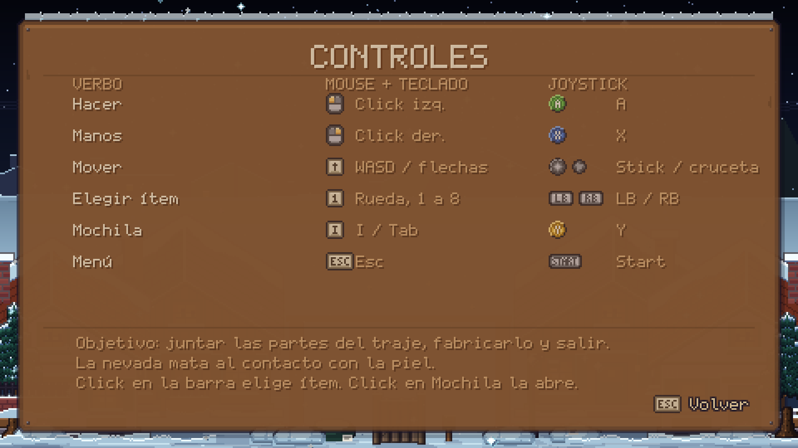

### Tipos de objeto

La mecánica básica: **todo lo que se toca en el mundo es de uno de ocho tipos, y el tipo define sus verbos.** Ningún mapa escribe textos de acción a mano: cada objeto declara `type` y `name` ("el parlante") en `src/maps/*.js`, y los verbos salen de `src/data/types.js` y `src/actions.js`.

| Tipo | Ejemplos | Hacer | Manos | Con un ítem en la mano (Hacer) |
|---|---|---|---|---|
| **Decorado** | biblioteca, reloj, foto, parlante, auto | Mirar | — | si el ítem sirve ahí, ese uso |
| **Cosa** (suelta, apoyada o en el piso) | mate, lata, casco, botas | Mirar | **Agarrar** (si es agarrable) | — |
| **Superficie** | mesa, estante, mesa de luz | Mirar | **Dejar** el ítem | — |
| **Contenedor** | ropero, alacena, caja de municiones | **Abrir** | — | — |
| **Aparato** (con estado) | radio, ventana abrible, vela, cocina, electrógeno, extractor, pileta | **Prender / Apagar**, **Abrir / Cerrar** | la pava del fuego: **Agarrar la pava** | Poner la pava al fuego, Cargar nafta, Instalar el secador, Sellar la ventana, Tirar la yerba |
| **Persona** | Favalli, Lucas, Elena… | **Hablar** | — | Convidar mate |
| **Paso** | puertas, escalera, salidas | **Entrar / Salir / Subir / Bajar** | — | — |
| **Vista y asiento** | ventana del living, silla del truco | **Asomarse** · **Sentarse** | — | — |
| **Mueble liviano** (decorado movible) | sillas de la cocina, cajas, baldes, rueda | Mirar | **Levantar / Apoyar** | — |

1. **Hacer es el verbo del tipo;** si el tipo no tiene uno (decorado, cosa, superficie, mueble liviano), Hacer es **Mirar**: el diálogo propio del objeto si tiene, si no su línea. Mirar es lo único que no pide alcance: un cuadro se mira de lejos.
   - Con un ítem en la mano que sirve ahí, Hacer pasa a ese uso.
   - **Sin apuntar a nada, o con click sobre Juan,** Hacer usa el ítem en uno mismo (tomar mate, ponerse el traje).
   - **Hacer nunca agarra ni deja.**
2. **La línea de mirar de lo interactivo no se pierde:** si un objeto con verbo propio (radio, ropero, cocina, escalera, portón) tiene texto de mirar (`src/data/script.js`), Juan lo dice **la primera vez** que se lo usa, antes del resultado, y no lo repite (se guarda por partida). En un paso, la línea va antes de cambiar de ambiente ("Abajo están Elena y Martita."). Las personas no tienen línea aparte: Hablar ya lo cubre.
3. **Manos** hace lo que dice su nombre: agarra lo agarrable, deja lo que tenés en la mano en un lugar libre, levanta un mueble liviano y lo apoya.
4. **Los textos se arman solos** con el verbo y el nombre ("Hablar con Favalli", "Prender la radio", "Agarrar Mate", "Dejar Mate cebado").
5. **La barra muestra solo lo que suma:** Hacer (si hay algo que hacer), Manos (si hay algo que agarrar o dejar) y Mochila siempre. Nunca repite un texto.
6. **El cuadradito anticipa qué se puede hacer:** dorado en lo que tiene acción propia, brillito en lo agarrable, tenue en lo que solo se mira, ámbar fijo de lejos.
7. **Agregar un objeto es una línea** (tipo, nombre y, si tiene, diálogo). Un test verifica que todos tengan tipo válido y nombre.

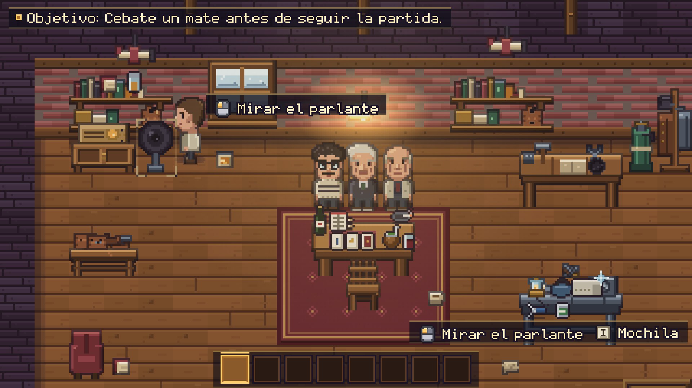
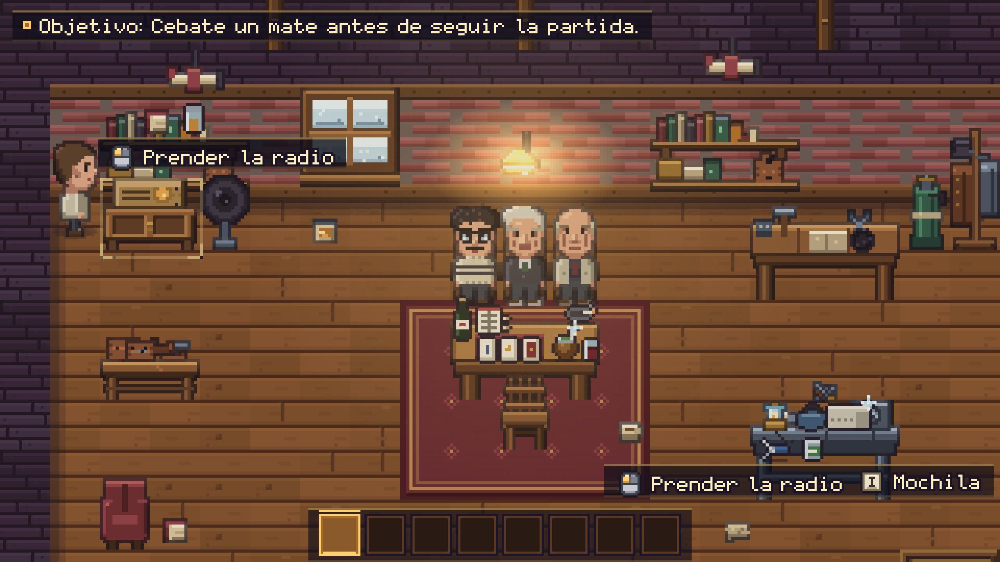
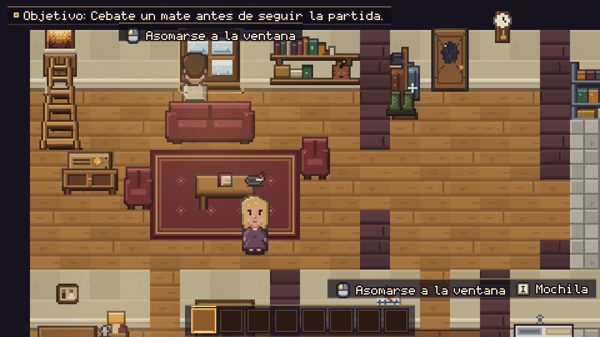
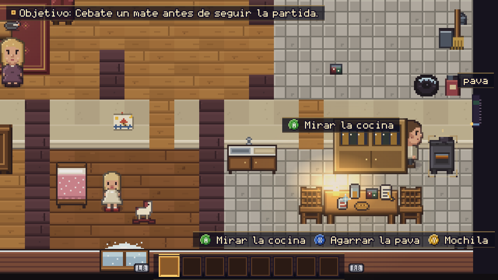
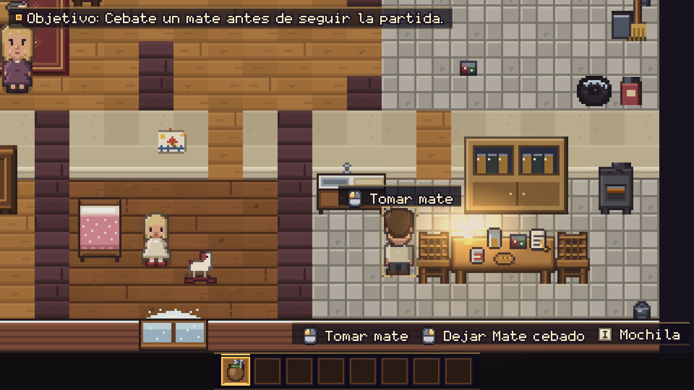

### Manos: agarrar, dejar y mover

Lámina de diseño: `../concept/out/manos.png` (fuente `art/concept/manos.py`).

1. **Dónde puede estar una cosa:** en la mochila, en un mueble, en el piso o en un contenedor. Moverla es agarrarla de un lugar y dejarla en otro. Todo queda donde lo dejaste aunque cambies de ambiente (estado por partida en `game.world`).
2. **En el piso:** una cosa por casillero (las iguales se apilan), con sombra y brillito. **No se junta sola** y no es sólida: se camina por encima y se agarra también parado encima.
3. **Dejar:** en el casillero de piso libre pegado a Juan, o en el lugar libre del mueble más cercano al puntero (o a Juan, con joystick).
4. **Silueta:** antes de soltar se ve la cosa al 55 % en el lugar exacto, con el cuadradito. Con mouse, en un lugar inválido, la silueta se tiñe de rojo suave (`#f09a7a`) y aparece "No entra ahí.".
5. **Nunca se deja algo donde después no se alcance:** solo en casilleros caminables, sin tapar un paso ni el acceso de otro objeto ("Taparía el paso."). Se chequea con la regla de alcance (`src/placement.js` + `src/reach.js`).
6. **Muebles livianos** (lista cerrada en los mapas, `movable: true`: cajas, valija, sillas de la cocina, baldes, rueda, bidón de la entrada, caballito, banquito; nunca las sillas del truco ni lo que usa la historia):
   - Manos los levanta **sobre la cabeza**, sin usar la mochila; Juan camina al 80 %.
   - Manos (o Hacer) los apoya en el casillero de adelante, con silueta.
   - Cargando uno no se agarra otra cosa y no se cambia de ambiente ("Primero apoyá la silla."). Si la historia saca a Juan del lugar, el mueble se apoya solo.
7. **Las cosas de la historia se pueden dejar como cualquier otra:** los objetivos cuentan la mochila y nada queda donde no se alcanza.

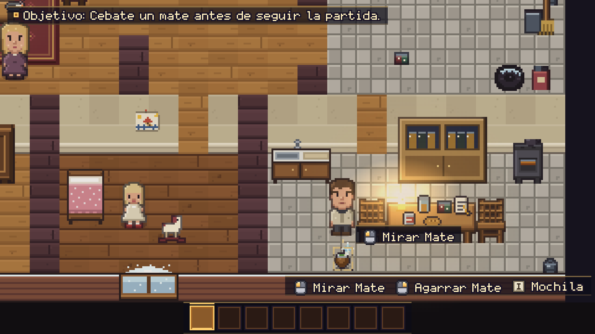

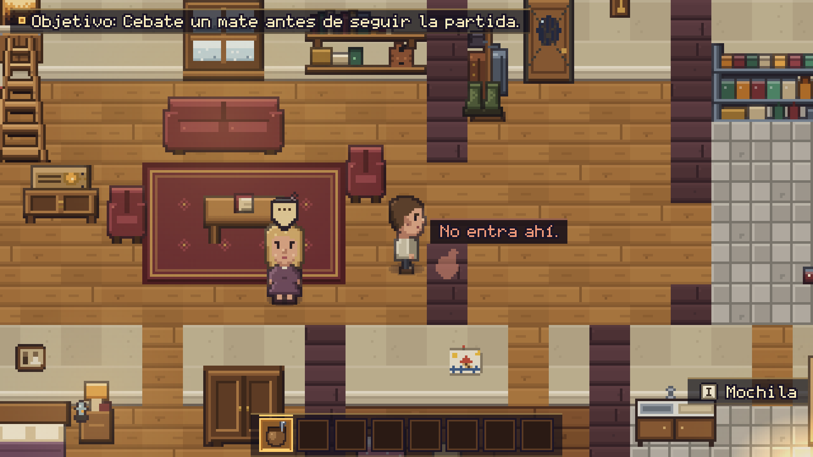
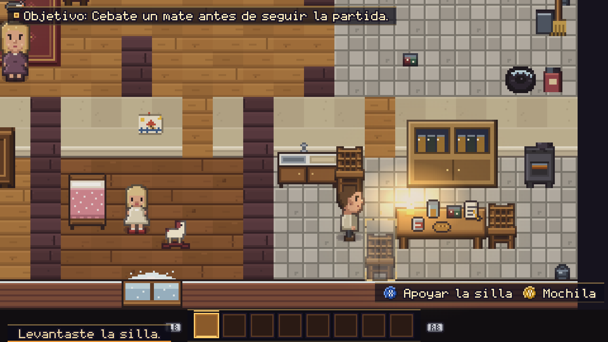
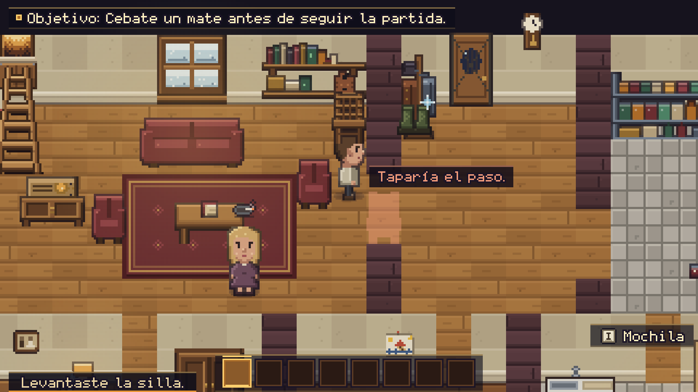

### Alcance: casilleros de acceso

Todo se rige por la grilla de 16 px:
1. **Huella:** son los casilleros que ocupa el objeto. Un mueble ocupa los que pisa. Un objeto de pared (ventana, estante, cuadro, extractor) ocupa la fila de pared donde cuelga.
2. **Casilleros de acceso:** son los de piso pegados a la huella (arriba, abajo y a los costados). En la pared, el de piso justo debajo.
3. **Regla única:** un objeto se alcanza si Juan está parado en uno de sus casilleros de acceso.
   - Con el joystick, además tiene que mirarlo.
   - Con el click alcanza con estar ahí, y Juan se da vuelta solo.
   - Lejos: "Acercate un poco." (Juan **no** camina solo).
4. **Lo apoyado** (un mate sobre la mesa, un frasco en un estante) se alcanza desde los accesos del mueble que lo sostiene.
5. **Los muebles bajos** (sofá, mesa baja, cama, banco) no tapan el acceso: se alcanza lo que está detrás de ellos a un casillero de distancia. Así la ventana se mira por encima del sofá. Los muebles altos (alacena, ropero, biblioteca) sí tapan.
6. **Sin excepciones por objeto:** no hay `reach` sueltos. Los muebles bajos se marcan `low: true` en el mapa (sofá, mesas, camas, sillas, sillones, mesa de luz, bancos, y el radio y el parlante del altillo).
7. **Prioridad cuando hay cosas superpuestas:** primero lo apoyado, después la persona, después el mueble y al final la puerta o escalera. Entre iguales, gana el más chico. Es la misma prioridad con las tres formas de jugar.
8. **Un plano con un objeto sin acceso es un error.** Lo detecta `test/alcance_audit.test.js`, que recorre los cuatro mapas; en el juego real, `art/concept/auditoria_alcance.mjs` (hoy: altillo 36/36, casa 39/39, garaje 16/16, calle 5/5). Las cosas dejadas en el piso y los muebles movidos entran en el mismo chequeo.
9. **Objetos de pared** (reloj del hall, dibujo de Martita, foto de casamiento, ferretería) se alcanzan desde el piso de su lado de la pared: la foto, solo desde el dormitorio.

Código: `src/reach.js` (la regla), `src/interaction.js` (`pickTarget` / `pickAt`).

### El cuadradito (corchetes del objetivo)

- **Aparece solo cuando hay algo para hacer.** Nunca sobre el piso ni la pared vacíos.
- **Enmarca el dibujo,** recortado a los píxeles visibles, con 1 px de aire. Nunca la huella.
- **Marca exactamente lo que va a pasar:** es el mismo objetivo que la acción y que el texto de la barra.
- **Se desliza de un objeto al otro** en ~80 ms, y al aparecer hace un "pop" chico desde afuera hacia adentro.
- **No parpadea:** mientras Juan siga en un acceso del objetivo actual, no salta a uno vecino salvo que lo mire de frente.
- **Cerca:** dorado y latiendo. **Lejos (mouse):** ámbar `rgb(255,190,120)` fijo al 75%, sin latido. El brillito de "agarrable" se mantiene.
- Cada objeto aparece una sola vez en la lista de candidatos.
- Código: `src/cursor.js`.

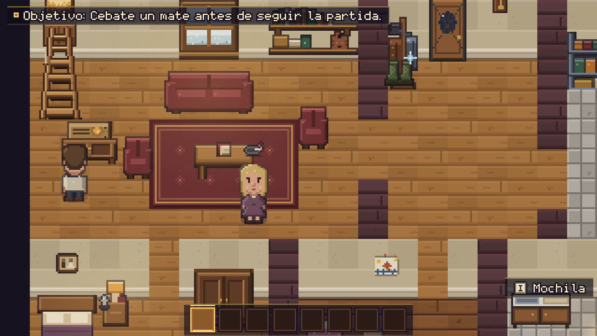
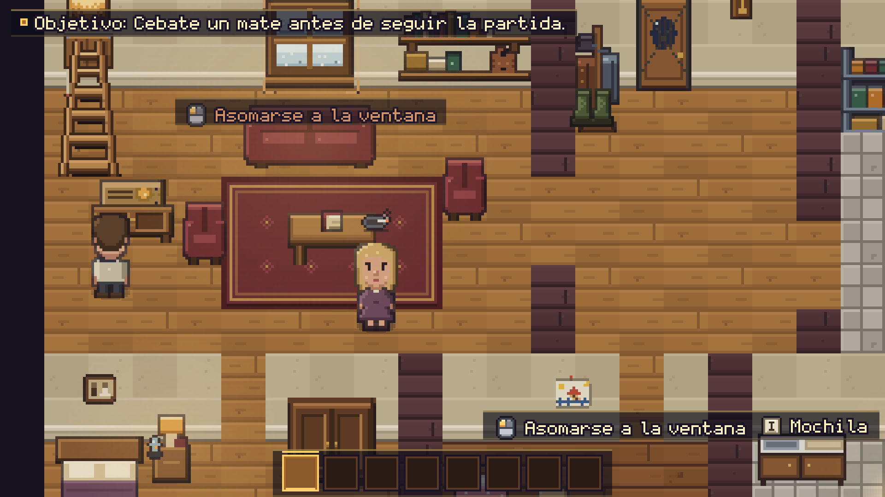
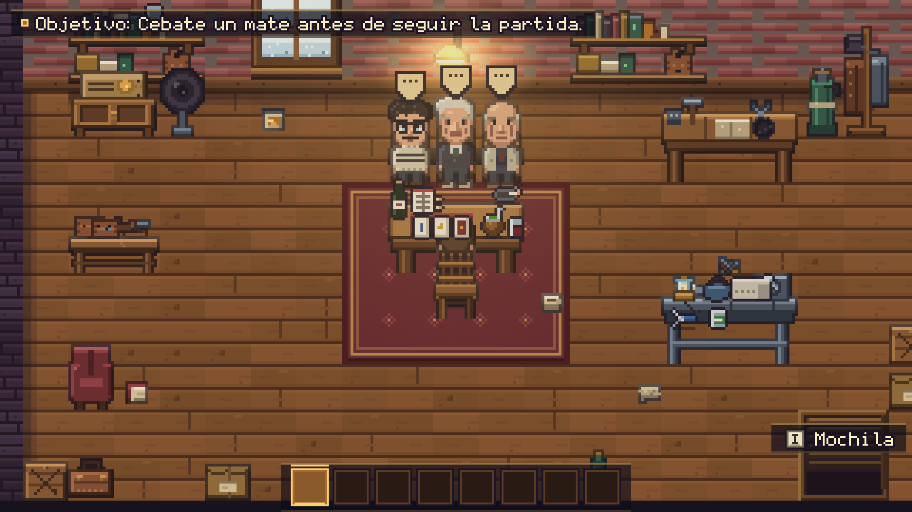
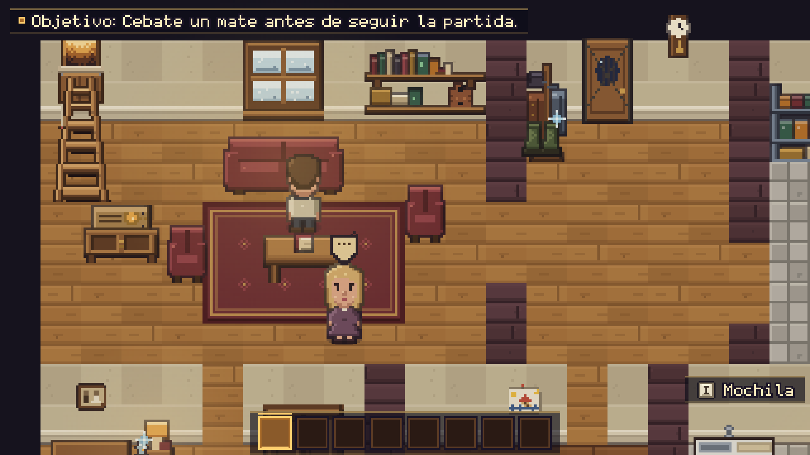

### Barra de acciones y dispositivos

- **Dos juegos de glifos:** mouse (`[click]`, `[click der.]`, `[I]`) o joystick (`[A]`, `[X]`, `[Y]`). Ejemplos:
  - mirando la radio: `[click] Prender la radio · [I] Mochila`;
  - frente al mate apoyado en la mesa: `[click] Mirar Mate · [click der.] Agarrar Mate · [I] Mochila`;
  - con el mate en la mano frente a un piso libre: `[click der.] Dejar Mate cebado · [I] Mochila`;
  - con el puntero sobre Juan y el mate cebado: `[click] Tomar mate · [click der.] Dejar Mate cebado · [I] Mochila`.
- **El texto de cada entrada es el de la acción real,** nunca "Usar" ni "Acción" a secas.
- **Cambio de dispositivo en caliente:** el mouse toma el control cuando se mueve más de 4 px o clickea; al tocar el joystick se esconde el puntero y el cuadradito vuelve al objetivo de adelante. Caminar con WASD no cambia el modo.
- **Joystick:** mapeo estándar (Xbox/PlayStation genéricos). Si no trae mapeo estándar, se usa igual con A=0, B=1, X=2, Y=3, LB=4, RB=5 y Start=9.

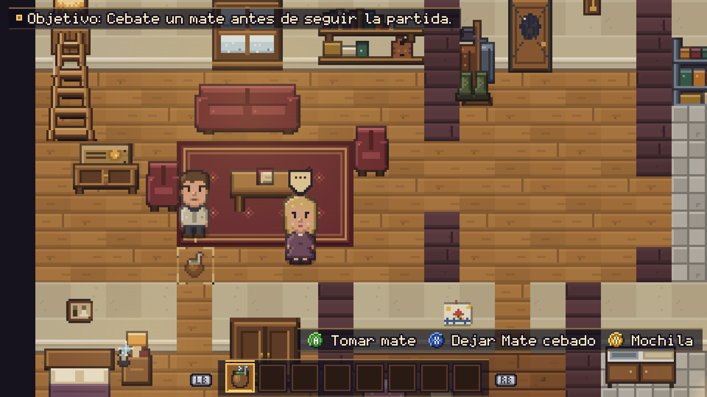
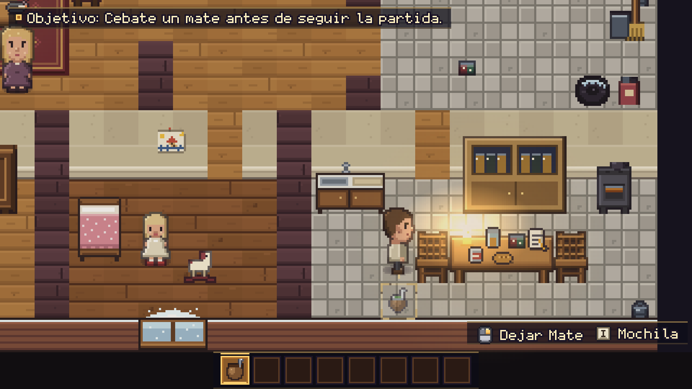

---

## La idea

**Lo que se ve es el cómic; cómo se dibuja es Stardew.** El contenido sale de las viñetas de Oesterheld y Solano López (1957). La técnica es pixel art de vista 3/4, formas limpias, colores cálidos y mucho objeto chico.

Tres reglas:
1. **Fiel al cómic.** Cada personaje se reconoce por una viñeta concreta. Lo que el cómic no muestra no se inventa.
2. **Simpleza con detalle.** Zonas grandes de color plano, y el detalle solo donde mira el ojo: caras, manos, el visor.
3. **Escala chica.** Grilla de 16 px, vista de 480×270, escalado entero.

Técnica:
- 3 o 4 tonos por material: base, sombra, sombra profunda y brillo.
- Sombras frías (hacia el violeta) y luces cálidas.
- Contorno un tono más oscuro que el relleno, nunca negro puro.
- Luz desde arriba a la izquierda, y una sombra redonda debajo de cada cosa.
- Si algo se ve recargado, sacar píxeles. Si se ve chato, sumar un brillo y una línea de sombra.

| Medida | Valor |
|---|---|
| Vista | 480×270 (pantalla ×4 = 1920×1080) |
| Personaje | 16×32 (1×2 baldosas); Martita, un tercio más baja |
| Mesa para cuatro | 3×2 baldosas |
| Objetos chicos | 8 a 16 px |
| Interfaz | barra de 20 px, letra de 7 px |

## Paleta

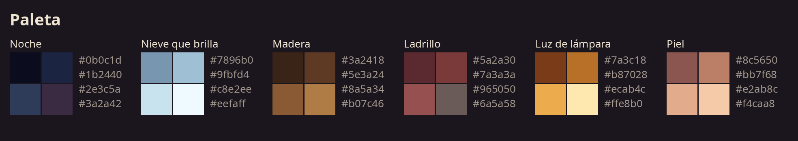

Afuera hay noche fría y nieve azulada. Adentro hay madera, ladrillo y luz de lámpara. **El contraste cálido/frío cuenta la historia: adentro se está a salvo y afuera la nieve mata.**

---

## Personajes

- Hoja: `public/assets/chars2.png` (celdas de 16×32; 8 columnas × 4 direcciones por personaje). Se edita en `art/sprites/` y se arma con `npm run sprites:pack`.
- Personajes: juan, juan_suit, juan_suit_rifle, favalli, lucas, polsky, elena, martita, polsky_coat.
- Rasgos que identifican a cada uno:
  - **Favalli:** anteojos de marco grueso.
  - **Lucas:** pelado y de saco claro.
  - **Polsky:** pelo blanco y traje oscuro.
  - **Elena:** rubia, de vestido violeta.
  - **Martita:** el único toque de rojo vivo en la casa.
  - **El traje:** tela engomada con parches, visera elíptica y filtro hecho con una lata.

### El traje

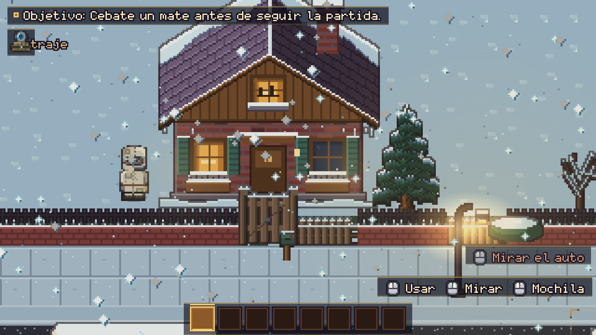
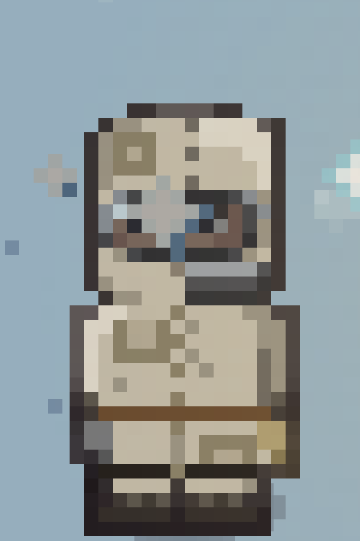

**El retrato `juan_suit` de 64×64 es la referencia** ("este es el mejor", 18/11). La cabeza del sprite es una copia a mano de ese retrato a la mitad (14×14), con la paleta exacta:
- **Visera:** se ve la cara de Juan adentro (piel en sombra `#786761` / `#675451`, cejas `#2d2c30`, ojos `#1f2330` con brillo `#81868a`). Marco gris-azulado (`#8a94a0` / `#3e434c` / `#262a32`) y un brillo `#c8dce6` arriba a la izquierda.
- **Capucha:** costura central punteada (`#6f6c66`) y parche cuadrado arriba a la izquierda (`#8e866e` / `#bcb4a0`). La costura sigue por la espalda.
- **Perfiles:** el vidrio azul pasa a ser cara (piel, ojo y ceja).
- La silueta no cambia respecto del traje anterior: solo se recoloreó el interior, en todos los cuadros y también con el rifle.
- Fuente: `art/concept/suit_unify.py` (`HEAD16`).

**El casco** (ítem `casco`, "Casco del traje", 16×16, 19/11) es la misma cabeza del sprite, subida una fila, con la visera de vidrio oscuro **sin cara** (es la máscara vacía) y la abertura de la capucha abajo. Fuente: `casco()` en `art/concept/planta_v4.py`.

Pendiente: [#10](#tablero) alturas del elenco · [#11](#tablero) variantes del traje.

## Animaciones

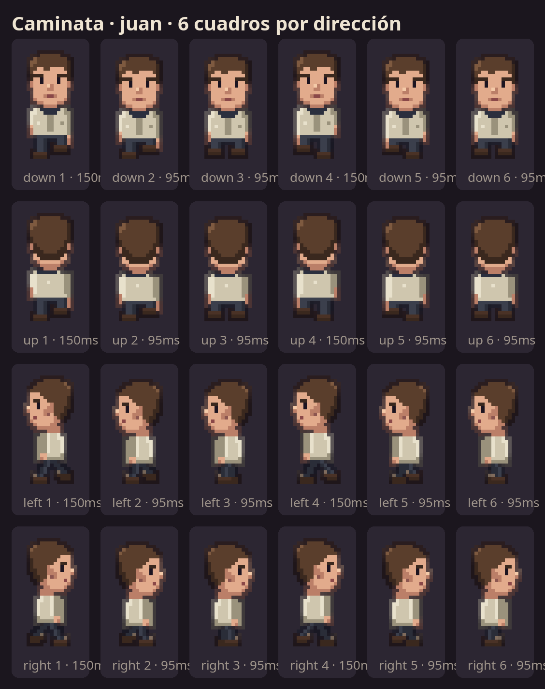

GIF con el ritmo real: [Juan](doc/laminas/anim_caminata_juan.gif) · [traje](doc/laminas/anim_caminata_juan_suit.gif) · lámina del traje: [anim_caminata_juan_suit.png](doc/laminas/anim_caminata_juan_suit.png)

- Caminata de 6 cuadros por dirección.
  - Tiempos: 150, 95, 95, 150, 95 y 95 ms. El contacto dura más que los intermedios.
  - Cabeceo: baja, baja y sube de golpe. La cabeza nunca cambia de forma, solo se desplaza.
- Reposo de 2 cuadros.

Pendiente: [#5](#tablero) inventario de animaciones que faltan.

## Diálogos y retratos

**Los retratos son las cabezas de los sprites** (encuadre B, aprobado el 18/11):
- Recorte de cabeza y hombros de 16×21 del sprite de frente, agrandado ×3 sin suavizar (48×63) y apoyado abajo en el recuadro de 64×64.
- Fondo del recuadro: `#2a2236`, el violeta oscuro de las viñetas.
- **Panel de 32×32:** el mismo recorte a tamaño real. Está implementado, pero hoy ningún diálogo lo usa.
- **Excepción: Juan con traje** conserva el retrato original de 64×64 (`art/sprites/portraits_dlg/juan_suit.png`, y `juan_rifle.png` con el arma), porque es la referencia del traje.
- **Los retratos salen del sprite, no de otra hoja.** Si el sprite cambia, el retrato cambia solo. `portraits_panel` ya no se usa.
- Código: `src/dialog.js` y `src/data/portraits.js`.
- Descartados: el duotono (17/11) y redibujar el elenco a 32×32 (`art/concept/portraits32*.py`, 18/11).

## Viñetas

Las secuencias de historieta: recuadros sobre papel, cartelas amarillas y globos.

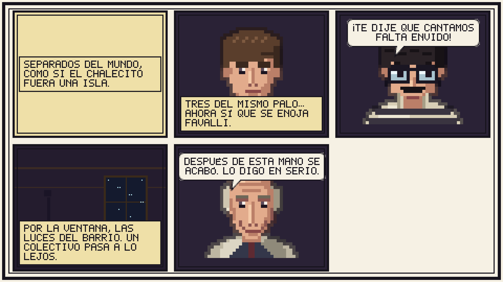
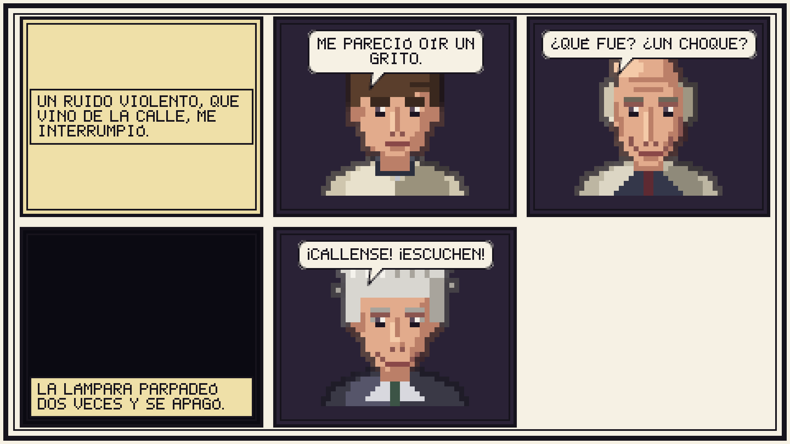

Cartela suelta (intro):

- Hoy los recuadros reutilizan los retratos de color viejos y las vistas de la ventana (`src/comic.js`). No pasaron a las cabezas de los sprites.
- Colores en `src/comic.js`: tinta `#16131c`, papel `#f6f1e4`, cartela `#efe0a8`, recuadro oscuro `#2a2236`.

Pendiente: [#2](#tablero) decidir retratos · [#3](#tablero) ilustrar recuadros vacíos y componer las páginas.

## Escenarios y construcción

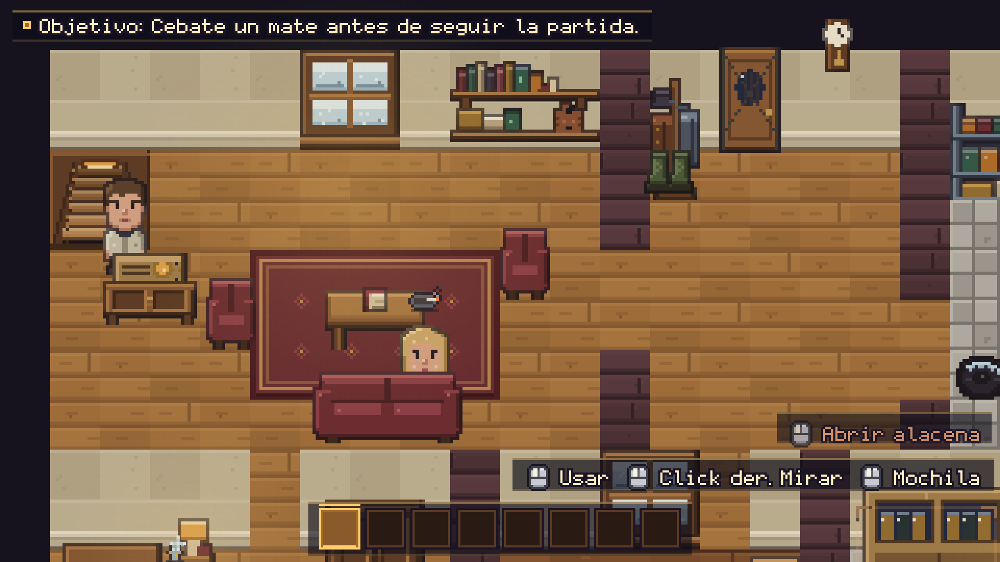
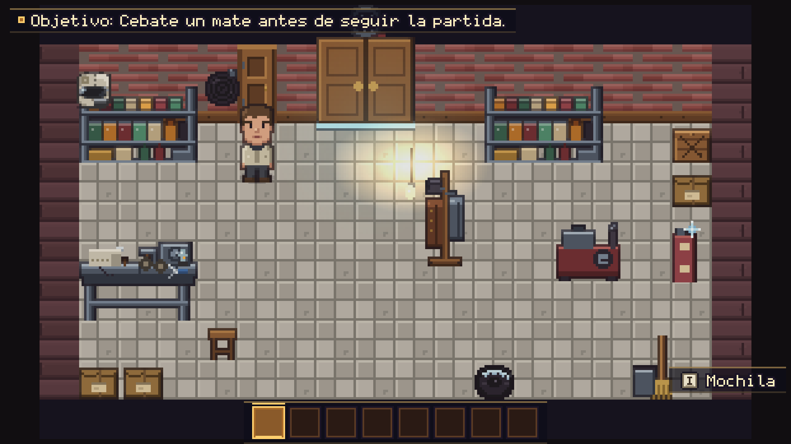
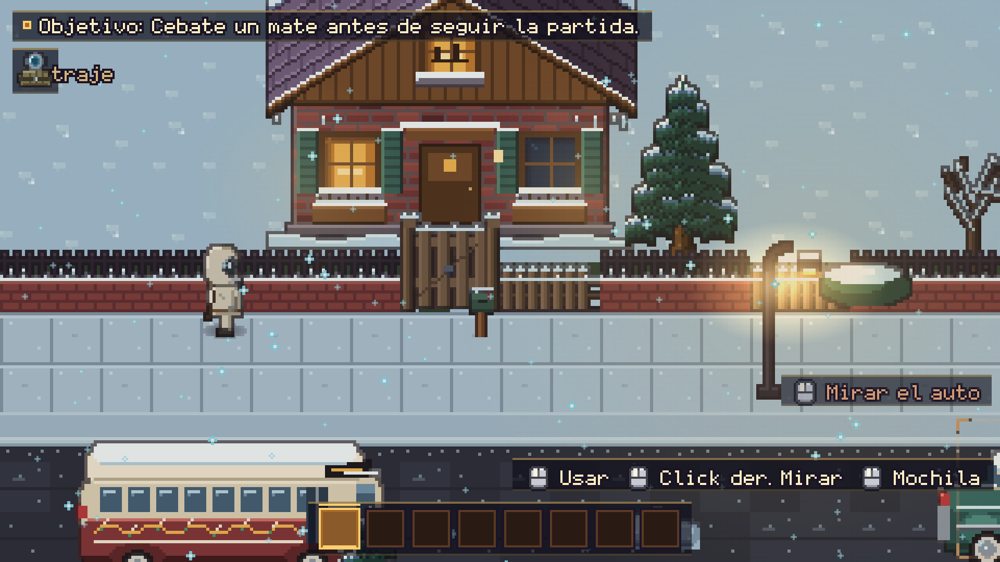

- El mundo se ve con un zoom de alrededor de 1,5× sobre la vista, siempre pixel-perfect (`src/viewport.js`).
- Las paredes interiores se ven de frente, como en Stardew, para que cada ambiente se entienda.

### Planta baja

Plano completo y cuarto de Martita:

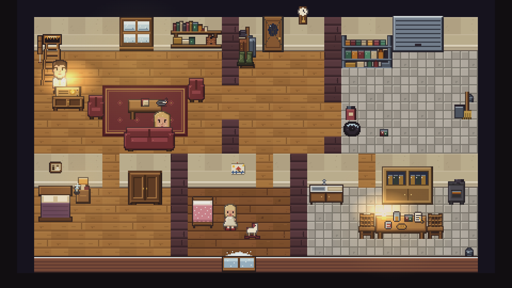
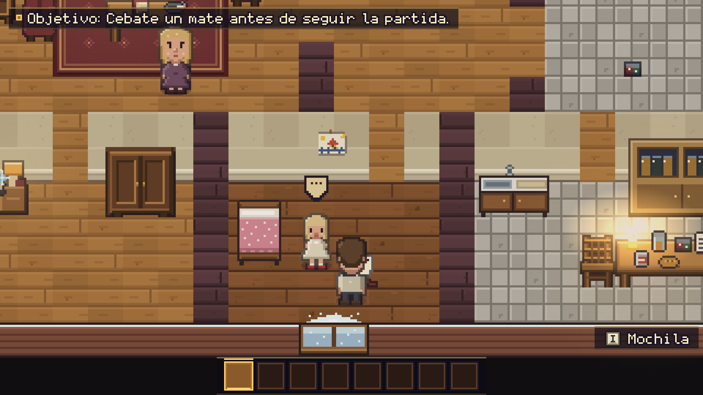

Cómo está (rediseño del 18/11 + ajustes v4 del 19/11, `src/maps/house.js`):
- **Living:** el sofá va contra la pared del fondo, bajo la ventana, mirando a la mesa ratona; los sillones a los costados, y Elena, la mesa y la radio donde estaban.
- **Escalera rebatible** (`stairs_attic`, 32×64, de y=16 a y=80): sale de una trampa en el borde de arriba de la pared, con el hueco cálido del altillo asomando, el labio de yeso, la tapa de tablones con bisagras colgando y el cordón con la perilla roja. Los largueros se abren hacia abajo y los peldaños son planos (los dos de arriba toman la luz del altillo). El área para subir (`stairs_up`) cubre todo el dibujo. Fuente: `escalera()` en `art/concept/planta_v4.py`.
- **Cuarto de Martita:** la ventana del objetivo está en la pared trasera, la exterior. Abierta tiene un montoncito de nieve en el piso (`snow_drift`), y cerrada no. En la pared interior hay un dibujo de Martita con crayón. Camita vertical de 20×30 con frazada rosa a lunares. Se sacó el cajón.
- **Cocina:** pileta en el rincón izquierdo, puerta libre, alacena a la derecha y una silla a cada lado de la mesa.
- **Dormitorio:** foto de casamiento sobre la cama.
- **Entrada al garaje:** la rueda y el bidón van dentro del ambiente, en el rincón de abajo a la derecha, sin tapar el paso del hall a la puerta del garaje.
- **Pared trasera:** 26 piezas `back_wall` sobre la fila 15.
- **Cámara:** puede bajar 17 px de mundo más allá del borde del mapa (`camBottomPad`), así la pared trasera queda arriba del HUD.
- Los objetos nuevos tienen texto para "Mirar".
- Fuentes del concepto: `art/concept/house_v2.py`, `house_v3.py` y `planta_v4.py` (este último sobre capturas del juego a 1x de `art/concept/capturas_planta.mjs`).

- **Etiqueta "Subir":** va a la derecha de la escalera, sobre la pared, para no tapar el dibujo ni a Juan (`labelSide: 'right'` en el warp).

El alcance de los objetos (qué se alcanza desde dónde) se rige por [Controles e interacción](#controles-e-interacción).

### Vista por la ventana del altillo

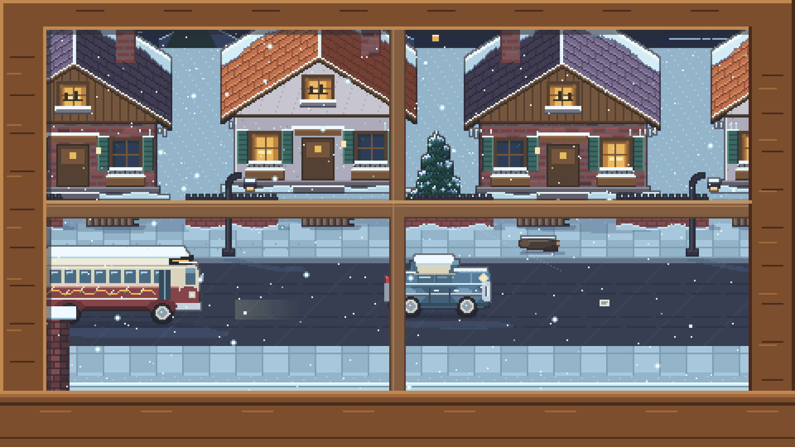

- Alrededor va la pared de ladrillo del altillo, oscura, para que no compita con la vista.
- Marco de 14 px con bisel (luz arriba a la izquierda, sombra abajo a la derecha) y veta que sigue la tabla. Travesaños de 6 px.
- Escarcha tramada (Bayer 4×4) en las esquinas de cada vidrio y dos rayas de reflejo.
- La nevada cae detrás del vidrio.
- Es una imagen fija con el vidrio transparente (`public/assets/views/attic_frame.png`, vidrio en x 36–443, y 24–222), encima del panorama y de los copos. Fuente: `art/concept/vista.py`.

Piezas:

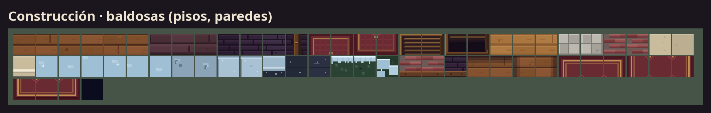
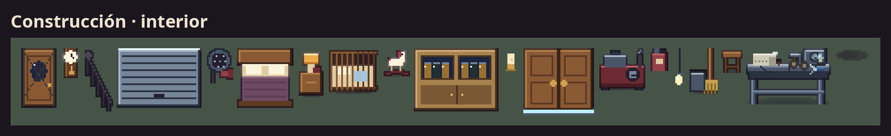

Pendiente: [#6](#tablero) fondo poblado de la calle.

## Objetos

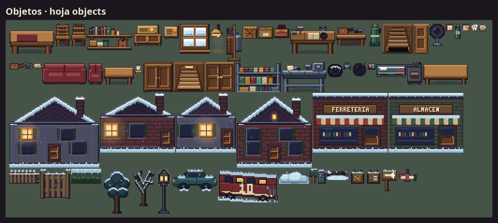

- Las mesas tienen la tapa lisa y contorno, así se leen bien con el zoom.
- Los objetos chicos de las superficies son los que se pueden agarrar.
- Nuevos el 18/11: lamparita del techo apagada (`hanging_lamp_off`), lámpara de aceite, camita, pileta, dibujo, foto de casamiento, ventana trasera, silla mirando a la derecha y montoncito de nieve.
- Redibujados el 19/11: escalera rebatible (32×64) y casco.

Pendiente: [#1](#tablero) banco de los violines · [#9](#tablero) interactivos vs. decorativos.

## HUD

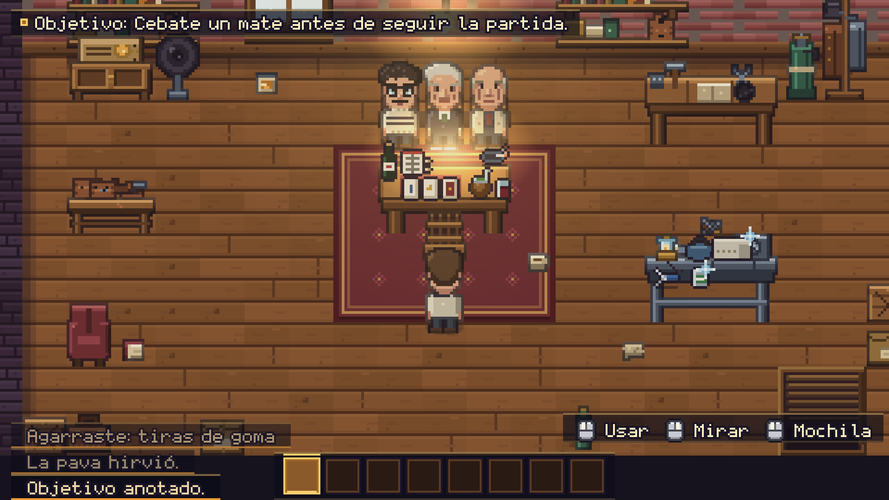

- **Arriba a la izquierda,** el objetivo.
- **Abajo,** pegada al borde, la barra de 8 casilleros. Encima, la barra de acciones, con los glifos del dispositivo actual y el texto real de la acción (ver [Controles e interacción](#controles-e-interacción)).
- **Avisos** abajo a la izquierda, apilados como en Stardew: el nuevo entra abajo y empuja a los anteriores. Máximo 3, duran 2,5 s y los viejos se ven al 60%.
- El HUD nunca se oscurece en el apagón: vive en su propia escena, que se dibuja después del post-proceso.

## Inventario, fabricar y cofres

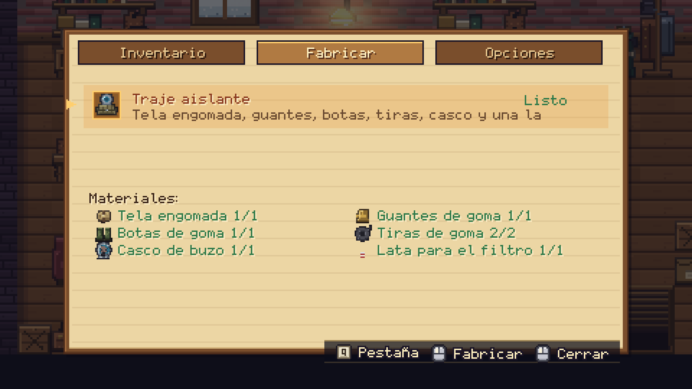

Ítems:

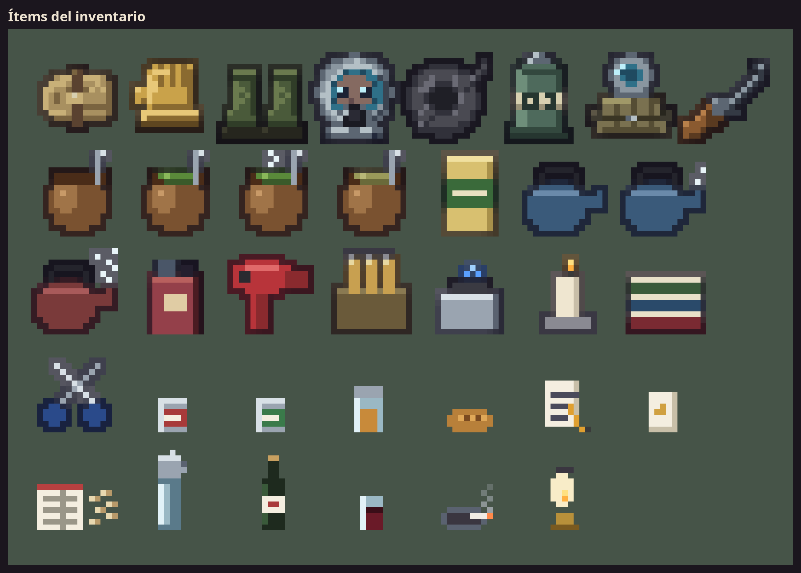

**La mochila es un cartel de madera** (19/11, `PauseMenu` en `src/menus.js`), con las reglas de los [menús de madera](#menús-y-pantallas):
- Cartel de 376×164 en (52,40), juntas cada 20 px, sin nieve. Tres pestañas como tablitas de 100×22 clavadas arriba; la elegida es más clara (`#9a663a`), mide 100×25 y queda pegada al cartel.
- **Inventario:** grilla de 6×3 casilleros tallados de 22 px; el elegido lleva marco ámbar `#ffcf6e`. A la derecha, la ficha: ícono ×2 en un hueco de 38×38, nombre en crema, "Para el traje" en ámbar si es material del traje y la descripción en `#d9ad7c`. Si falta algo para el traje, abajo dice qué.
- **Fabricar:** la receta en una fila tallada con la barra cálida, los materiales en dos columnas con su conteo (verde apagado si está, rojo suave si falta) y el botón "Fabricar" como tablita: apagada si falta algo, encendida si está lista.
- **Opciones:** "Reanudar" y "Volver al título" grandes, con la barra cálida y el copito; el aviso de que se pierde la partida y una plaquita tallada con el objetivo actual.
- Los glifos van abajo a la derecha, en una tablita oscura como la del título.
- **El cofre** ("Cajón de herramientas") usa el mismo cartel: título en una tablita clavada arriba, casilleros tallados, ficha con ícono ×2 y los glifos "Agarrar" / "Cerrar" en la tablita oscura.
- **Ícono de la lata** (19/11): lata de 10×15 con tapa, rebordes y etiqueta con franja crema, a la escala de los otros ítems del traje; `latas` es la misma lata en verde. Fuente: `art/concept/lata_icono.py`.

## Menús y pantallas

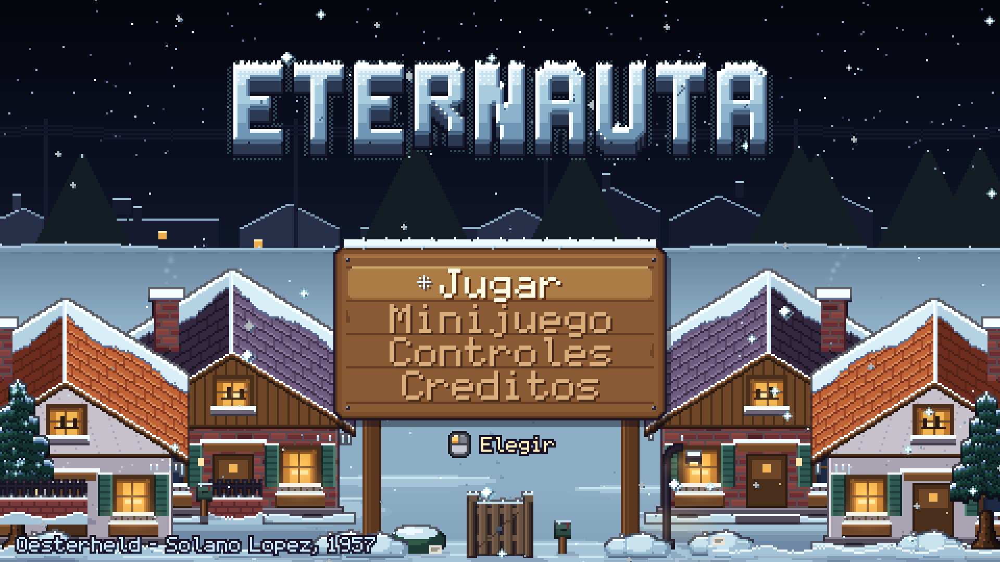

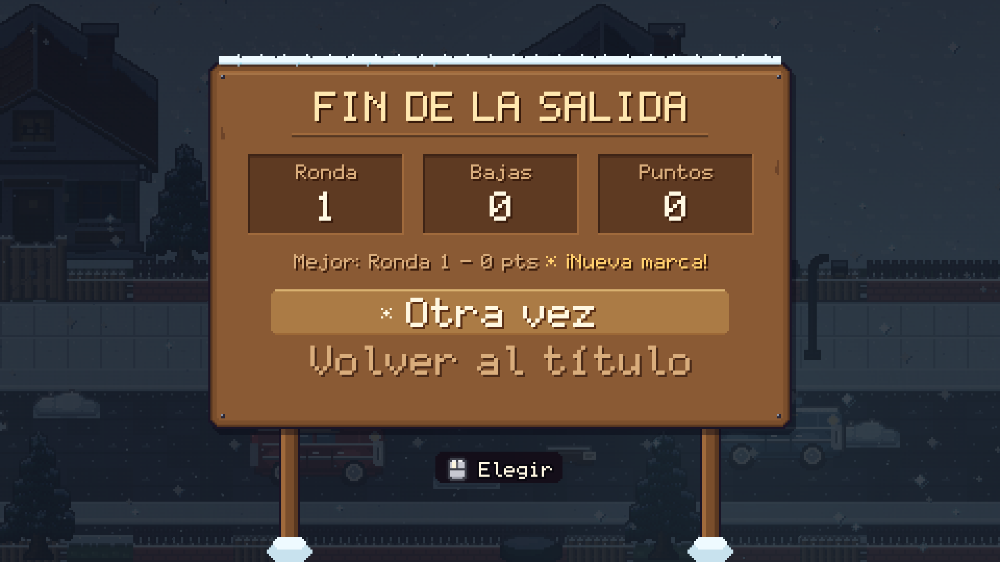
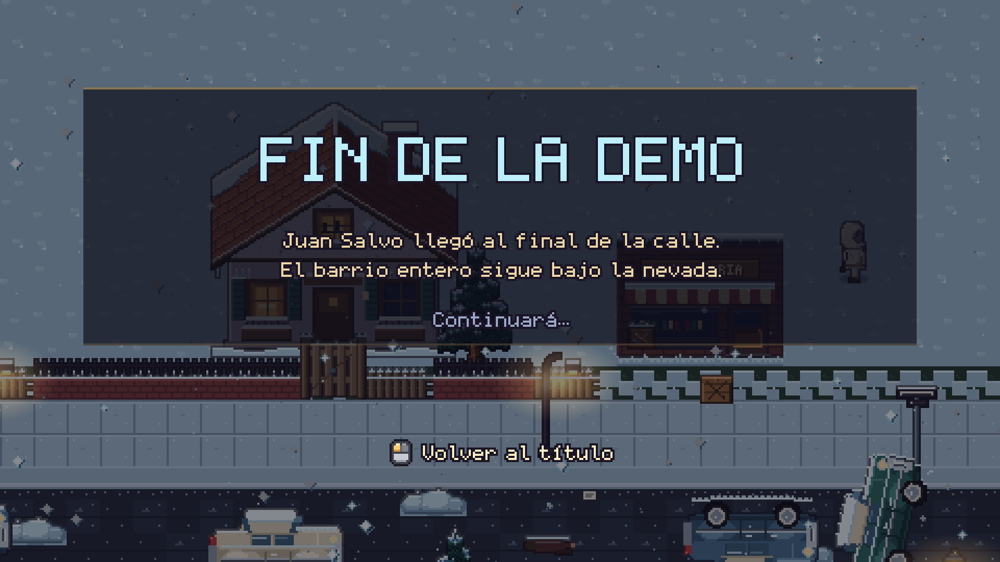

**Título:**
- **El logo solo dice ETERNAUTA,** dibujado a mano (276×63, `public/assets/title_logo.png`): letras propias de bloque, extrusión de acero azulado de 7 px hacia abajo, cara de hielo con bisel, escarcha y una grieta por letra, nieve acumulada arriba y un halo cian tramado.
- El volumen se inspira en los logos 3D de los 90, sin copiar letras ni texturas de nadie.
- El cartel de madera con las opciones queda como estaba.
- Cae la nevada fosforescente, la misma del juego.
- Fuente: `logo3d()` en `art/concept/titulo.py`. Se dibuja en `drawMain` de `src/menus.js`.

Piezas:

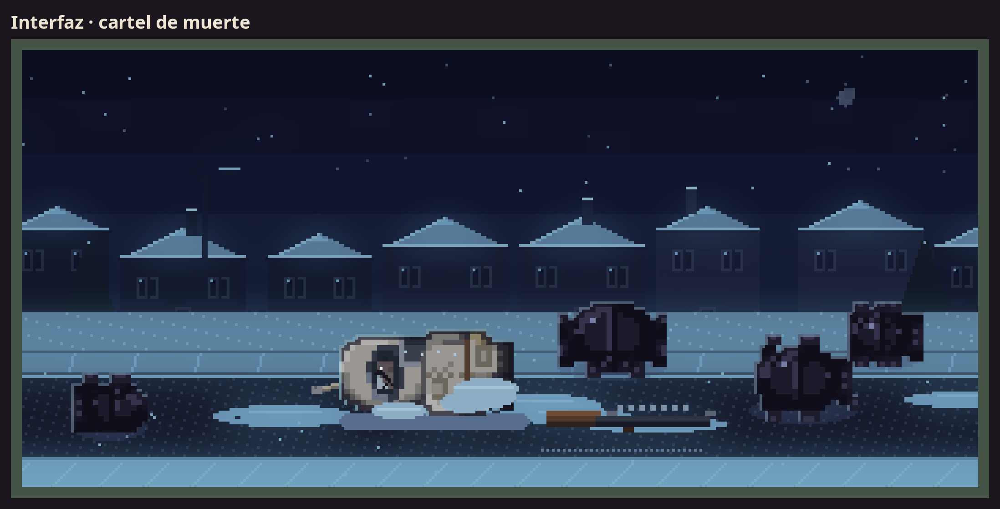

**Menús de madera** (19/11; la maqueta es `art/concept/menus_madera.py`, primitivas `woodSign`, `carve`, `amberFrame`, `flake` en `src/titleUi.js`):
- Mismo material que el cartel del título: marco de tres tonos, tablas con juntas, labio de luz y clavos.
- Adentro no hay papel rayado: lo que se lee va **tallado** en la madera (hueco con sombra arriba a la izquierda y labio de luz abajo a la derecha).
- Las pestañas son tablitas clavadas arriba del cartel. La elegida es más clara y queda pegada al cartel.
- La elección se marca con la barra cálida del título y el copito, o con un marco ámbar en los casilleros.
- Los textos que avisan que falta algo van en rojo suave (`#f09a7a`), y los que están completos en verde apagado (`#b8d890`).
- Adentro de la casa, sin nieve. El fin de partida es afuera: el cartel lleva nieve y está sobre dos postes.

**Fin de partida del minijuego** (`src/arena/resultScreen.js`): cartel de 280×176 con nieve sobre dos postes que bajan hasta montoncitos de nieve. "FIN DE LA SALIDA" grande, tres huecos tallados (Ronda, Bajas, Puntos) con el número grande, la mejor marca con "¡Nueva marca!" en ámbar si es récord, y las opciones como en el título. El glifo "Elegir" va entre los postes.

Pendiente: [#12](#tablero) captura de Créditos. La pantalla de Controles está en [Controles e interacción](#controles-e-interacción).

## Cursor

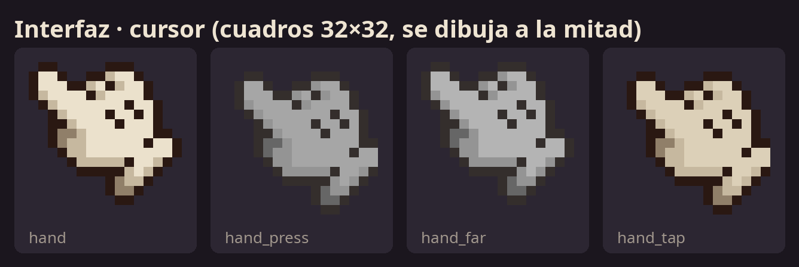

- Es el guante blanco del pack descargado (`art/cursores/src_pointer.png`), pasado a la paleta beige.
- Es un cursor de hardware (CSS): no tiene demora detrás del mouse.
- **Click:** la mano entera se hunde 1 px en diagonal y se oscurece un tono. Queda hundida mientras el botón está apretado, con un mínimo de 120 ms.
- **Lejos:** la misma mano en gris.
- **En el combate no hay guante:** ver [Enemigos y minijuego](#enemigos-y-minijuego).
- Fuente: `art/sprites/cursor/`.

Pendiente: [#7](#tablero) hover y versión de lejos · [#8](#tablero) crédito del pack.

## Enemigos y minijuego

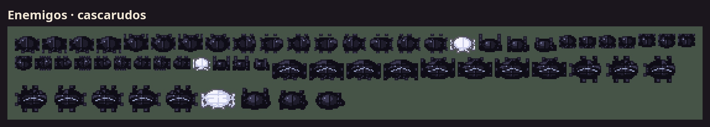

- **En el combate no se ve el guante**, tampoco al hacer click. La única referencia de puntería es la mira de siempre (la cruz de nieve con el centro blanco, `drawCrosshair` en `src/scenes/arena.js`).
- Con mouse, la mira va bajo el puntero. Con joystick, a 24 px del jugador en la dirección de puntería.
- Al salir del combate (resultado, muerte, menús) vuelve el guante.

Diseño completo en `Eternauta-enemigos.pdf` (cascarudos y la Mano):

Pendiente: [#4](#tablero) sumar la Mano.

## Roguelike (en diseño)

**Concepto, no está en el juego.** Narrativa y decisiones en `docs/roguelike_narrativa.md`. Generador: `art/concept/roguelike.py` (salida completa en `art/concept/out/roguelike/`). Todo parte de los sprites del juego: el viejo sale de Lucas, el programador de Juan, y los muebles y baldosas son los mismos. Tablero: [#13](#tablero).

La idea en una línea: Juan, perdido en el continuum, cae en el **universo 16 bits** y queda en un loop de la noche de la nevada. Un gag con el programador lo explica, después está la nevada, el traje se arma una sola vez, la calle es el roguelike y la casa es la base de mejoras.

### Personajes

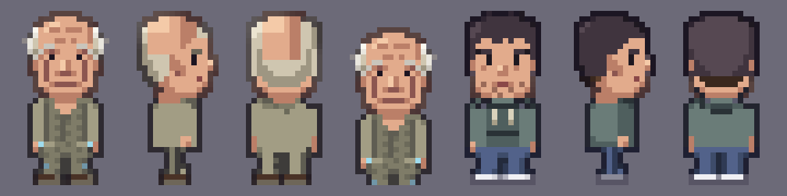

- **El Eternauta viejo** (p014–p015): casi calvo, mechones blancos, ojos hundidos y cansados, túnica de **trama rara** (gris verdoso, de ninguna época). Tiene un **hilo cian del continuum** en el ruedo y los puños: lo único que trae de afuera.
- **El programador:** buzo con capucha, auriculares al cuello, barba de días y ojeras. Es genérico, no es nadie en particular. Sin anteojos, porque en 16 px se leían como lentes de sol.

### El cuarto del programador

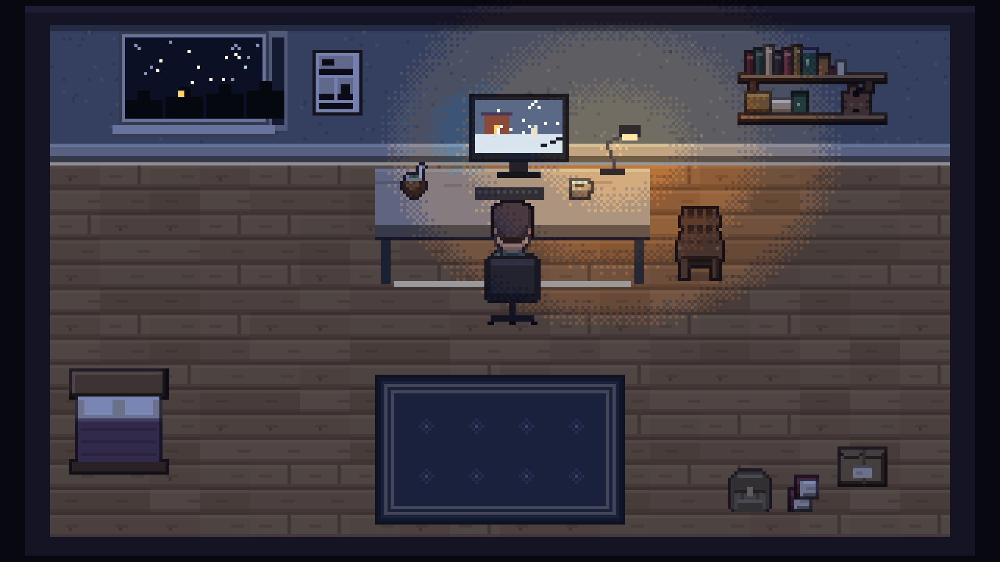
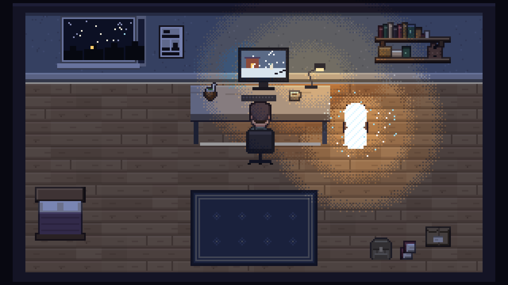

- Mundo con el zoom 1.5× del juego. Luz con la regla del apagón: lámpara cálida y pantalla cian (el cian de la nieve).
- Guiños a la p013: la ventana de noche con estrellas y la **silla de visitas** de madera oscura con remates redondos. En la pantalla está **este juego** (la calle nevada). En la ventana cae **el primer copo**, cian. Hay una mochila tirada en el piso.
- **La llegada:** la mancha blanca toma la forma del viejo sentado, con chispas del continuum.

### El gag

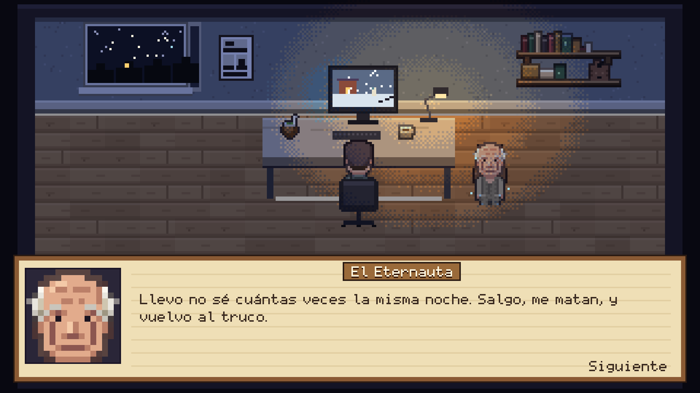
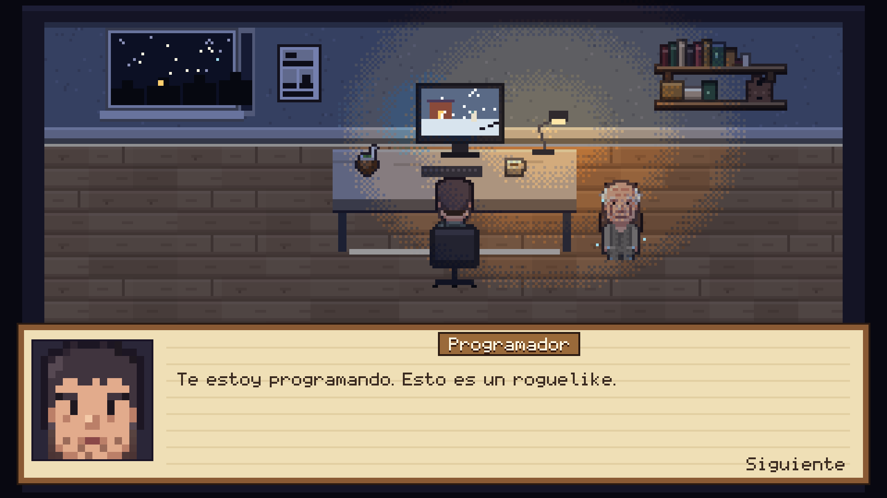
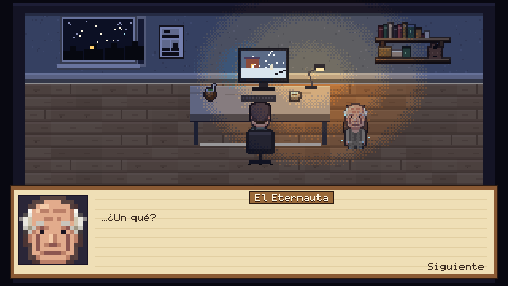

Cinco líneas con el cuadro de diálogo de siempre y retratos de cabeza de sprite. Las cinco están en `art/concept/out/roguelike/gag_*.png`.

### La llegada: la tinta se vuelve píxeles

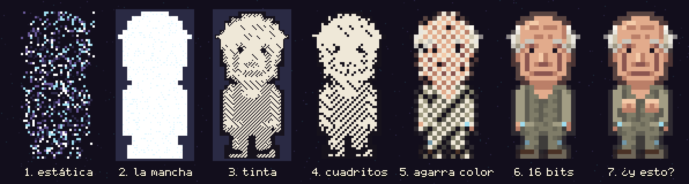

Es la animación de entrada al universo 16 bits. La tinta es **el mismo sprite pasado a pluma** (negro, papel y rayado); no copia el dibujo de Solano López. Después se cuadricula, agarra color con tramado Bayer, queda en el sprite del juego y Juan se mira las manos.

### Botín y la mochila de "otra vez"

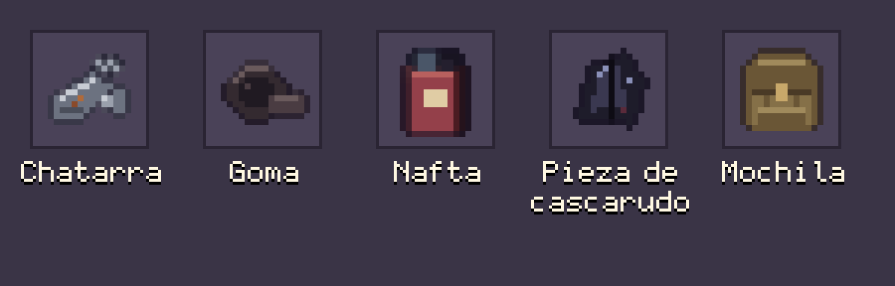
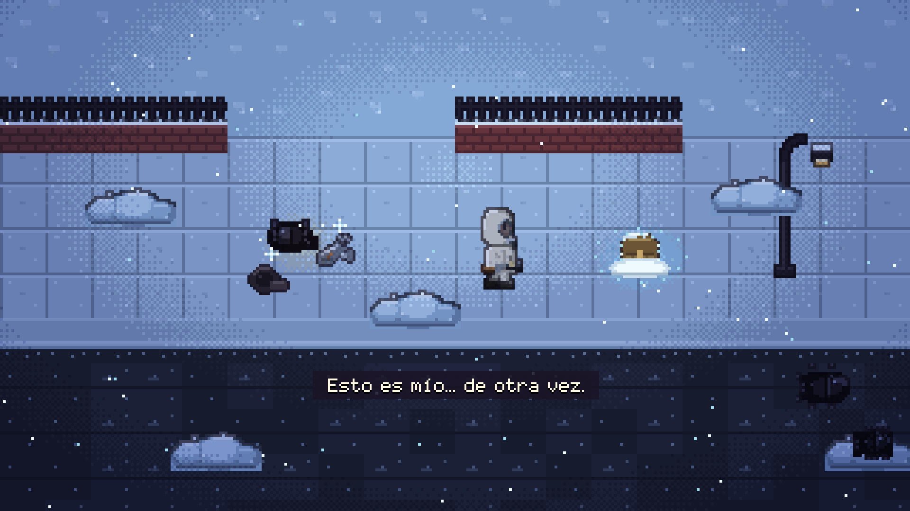

- Íconos de 16×16 con contorno de color: **chatarra**, **goma** (tira de cámara), **pieza de cascarudo** (élitro con el brillo frío de su paleta) y la **mochila**. La nafta es la que ya está en el juego.
- **La mochila de otra vez** (lo que queda al morir): medio enterrada en la nieve, con un **temblor cian** en el borde. **No toma la luz de la noche**: conserva sus colores cálidos en medio del azul, porque no es de esta noche. Así se ve desde lejos.
- En el apagón, la farola está apagada.

### La casa como base

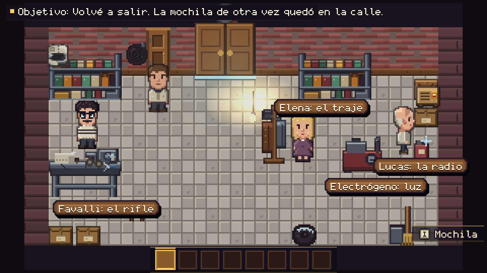

- **Cuatro estaciones en el garaje:** Favalli en el banco (el rifle), Elena al lado del traje colgado (el traje), Lucas, radioaficionado, con la radio (rumores de la noche, sobrevivientes y gags de lo que agarra: ver `docs/roguelike_narrativa.md`) y el electrógeno (luz y fuego, con nafta).
- **El taller** es el cartel de madera de la mochila. Las pestañas son las cuatro estaciones, con la cabeza de cada uno y la bengala para el electrógeno. A la izquierda están las tres mejoras, que son un camino y se hacen en orden: hecho, disponible, bloqueado con candadito tallado. A la derecha, la ficha con el costo en botín, en verde si alcanza y en rojo si falta.
- **Las doce mejoras** (generador: `art/concept/roguelike_casa.py`, lista en `docs/roguelike_narrativa.md`). Los costos son una primera pasada. La pieza de cascarudo es la cara.

### El barrio: las manzanas

El barrio es una **grilla de piezas de 20×20** con salidas fijas (este/oeste por la calzada, norte/sur por la bocacalle), y cada loop lo arma en otro orden. Para que no sea siempre una calle horizontal, cada pieza tiene otra forma. Generador: `art/concept/manzanas.py`. Detalle en `docs/roguelike_narrativa.md`.

- Todo sale de las baldosas y sprites de la calle del juego. Se dibujaron nuevos, con las mismas reglas: bicicleta, banco de plaza, busto, hamaca, baranda, vagón del Mitre, barrera, garita, cruz de San Andrés, alambrado, paredes de ladrillo, vidriera rota, buzón del Correo y plátanos de vereda.
- **El borde del loop:** donde no hay pieza (y en el borde del mapa), el barrio se termina en **estática del continuum**, la misma de la llegada. Contra el borde, la pieza se deshace en cuadraditos con tramado Bayer, como la llegada al revés. Adentro de la estática, a veces se entrevé el fantasma de otra noche, y la cruzan rayas de interferencia como de radio mal sintonizada. La luz del apagón no la toca.
- Cada ficha trae la pieza, el **plano de juego** (salidas, médanos de donde salen, botín y trampa) y cómo se ve en el apagón.

### Investigación: la Biblioteca Nacional (queda como research, no se implementa)

Guiño a *El atajo: La batalla de la Biblioteca Nacional* (Sasturain y Solano López, 2007): un Mano trae el edificio del futuro con un materializador. Para nosotros es una anomalía de otro tiempo, con estática del continuum en los bordes. La manzana es la real: Las Heras arriba con la Plaza del Lector, la Biblioteca en la meseta, la barranca y la plaza de abajo hasta Libertador, la Plaza Mitre cruzando Agüero y el Palacio Unzué como imagen emergente. Detalle, fuentes e ideas de juego en `docs/mapa_biblioteca.md`. Generador: `art/concept/biblioteca.py`.

## Efectos e iluminación

### Luz del apagón

Las cuatro escenas durante el apagón:

Concepto (izquierda) y juego (derecha): [altillo](doc/capturas/pi_1_altillo_compare.png) · [planta baja](doc/capturas/pi_1_casa_compare.png) · [calle](doc/capturas/pi_1_calle_compare.png)

Es un post-proceso sobre la escena (`src/lightpost.js`, fuentes de luz en `src/apagon.js`). Detalle técnico en `docs/iluminacion_apagon.md`.

**Reglas:**
- **Oscuridad legible.** Lejos de la luz, todo se sigue leyendo: es una repaleta nocturna, no negro. Desatura un 30% y multiplica por `0.49, 0.55, 0.79`. Nunca un velo con transparencia.
- 4 bandas de luz por fuente, con tramado Bayer 4×4 solo en el borde entre bandas.
- Cada banda se recolorea con su fuente: vela `1.25, 1.06, 0.80` · brasa `1.22, 0.80, 0.58` · nieve `0.62, 0.92, 1.12`.
- Los vidrios que dan a la nevada brillan cian.
- Viñeta escalonada: ×0.88 y después ×0.76 en los bordes.
- Parpadeo: el borde de las bandas se mueve entre 1 y 3 px. Nunca cambia la transparencia.
- Llama de la vela: 2 o 3 px blanco-amarillo-ámbar. La llama, el pucho y el humo son píxeles sobre la escena y debajo del HUD.
- **El HUD nunca se oscurece.**

**Por escena:**
- **Altillo:** la vela de la mesa. Lucas fuma: la brasa es más roja que la vela y se aviva cuando pita (reposo de 1,2 s, pitada que sube en 110 ms y se sostiene 380 ms, se apaga en 560 ms). Sube un hilo de humo gris de 5 px.
- **Planta baja:** lámpara de aceite sobre el mueble de la radio. La ventana y el ojo de buey de la puerta son fuentes frías. El pucho del cenicero respira solo, ilumina el borde de la mesa y a Elena. La lamparita del techo usa su cuadro apagado, sin cono y con el vidrio frío.
- **Calle:** farolas apagadas, sin halo. La nieve es la luz del suelo: no se apaga, se enfría. Una sola ventana conserva una vela.
- **Garaje:** el electrógeno es la única luz cálida, y el portón deja entrar un haz frío.

Diferencia con el concepto: la brasa de Lucas usa un radio de `5+12k` px (el concepto usaba `8+18k`).

Fuentes del concepto: `art/concept/lighting2.py` (altillo) y `art/concept/lighting3.py` (casa, calle, pucho, lamparita).

### La nevada

De día y en el apagón:

- **Tres capas, siempre a tamaño real** (1 px del sprite = 1 px de la vista) **y sin transparencia:**
  - **atrás:** puntos de 1 px `#c8e2ee`, lentos (8–16 px/s)
  - **medio:** cruces de 3×3 blancas con una sombra de 1 px abajo a la derecha (`#4a6a8a`), a 18–30 px/s
  - **adelante:** estrellas de 5×5 con sombra, rápidas (40–60 px/s)
- **La sombra** hace que se lean sobre la nieve clara. Sobre fondo oscuro manda el blanco.
- **Fosforescente:** cada copo se enciende y se apaga despacio mientras cae, con su propio ritmo. Encendido tiene centro blanco y halo cian de 1 px (`#96e1f0`). Apagado es el mismo copo, un 28% más oscuro.
- Se mantienen las ráfagas de viento y el vaivén.
- Es la misma nevada en la calle, el título, la vista del altillo, la muerte, el final y el minijuego (`src/snow.js`, texturas en `public/assets/snow_flakes/`). Fuente: `art/concept/nieve.py`.

---

## Assets abiertos

Packs con licencia abierta que pueden servir de base para redibujar (hoy: el banco de los violines, [#1](#tablero)). **Nada se pega tal cual:** el estilo es propio (paleta, contorno, luz arriba a la izquierda), así que sirven como punto de partida o como referencia de construcción. Antes de usar uno, leer la licencia en su página y anotar el crédito en Créditos.

| Pack | Licencia | Grilla | Qué sirve | Ojo |
|---|---|---|---|---|
| [Kenney · Roguelike/RPG pack](https://opengameart.org/content/roguelikerpg-pack-1700-tiles) | CC0 | 16 px | Camas, sillas, bibliotecas | Muy simple y de otro estilo: sirve como base de construcción |
| [Kenney · Roguelike Indoor Pack](https://opengameart.org/content/roguelike-indoor-pack) | CC0 | 16 px | Muebles de interior | Mismo estilo simple |
| [Ninja Adventure (Pixel-boy)](https://pixel-boy.itch.io/ninja-adventure-asset-pack) | CC0 | 16 px | Vista 3/4 parecida a la nuestra | Pocos muebles de interior; temática japonesa |
| [Interior tileset 16x16 (Bonsaiheldin)](https://opengameart.org/content/interior-tileset-16x16) | CC-BY-SA 3.0 | 16 px | Muebles de casa | Share-alike: lo derivado queda con la misma licencia |
| [LPC Wooden Stairs (Nyom)](https://opengameart.org/content/lpc-wooden-stairs) | CC-BY-SA 4.0 | 32 px | Escaleras y barandas de madera | Escala LPC (32 px): solo como referencia de construcción para la escalera |
| [LPC Upholstery (bluecarrot16)](https://opengameart.org/content/lpc-upholstery) | CC-BY-SA 4.0 y otras | 32 px | Sillones, sofás y almohadones | Escala LPC: referencia para el sillón del living |
| [LPC Woodshop (bluecarrot16)](https://opengameart.org/content/lpc-woodshop) | CC-BY 3.0/4.0, OGA-BY, GPL | 32 px | Banco de carpintero y herramientas | Referencia para el banco de Polsky |
| [LPC Wooden Furniture (bluecarrot16)](https://opengameart.org/content/lpc-wooden-furniture) | ver la página (pide link y créditos) | 32 px | Mesas, camas y armarios de madera por capas | Escala LPC |
| [Furniture Pack (Mullenratte)](https://mullenratte.itch.io/furniture-pack-mullenratte) | CC-BY 4.0 | 16 y 32 px | 71 muebles | Pide crédito |
| [Autumn Tiny Room (IvoryRed)](https://ivoryred.itch.io/autumn-tiny-room) | CC-BY 4.0 | 16 y 32 px | Muebles cálidos de madera | Pide crédito |
| [Furniture set (SunGraphica)](https://sungraphica.itch.io/furniture-set-pixel-art) | CC-BY 4.0 | 16 px | Mesas y muebles chicos | Pide crédito |
| [Post-apocalyptic Workshop (0_mem0ry)](https://0-mem0ry.itch.io/post-apocalyptic-workshop-set-free) y [Makeshift Furniture](https://0-mem0ry.itch.io/makeshift-furniture-set-free) | licencia propia: uso libre, sin redistribuir | 16/32 px | Bancos de taller, cajones y herramientas | Leer la licencia |

**Interfaces de madera** (se miraron para los menús; al final se dibujaron propios a partir del cartel del título):

| Pack | Licencia | Qué trae | Ojo |
|---|---|---|---|
| [Game wood panel (OpenGameArt)](https://opengameart.org/content/game-wood-panel) | CC0 | Panel de madera pintado (no pixel art) | Solo como referencia de material |
| [Parchment GUI (OpenGameArt)](https://opengameart.org/content/parchment-gui) | CC0 | Papel con casilleros, 16 px | Pergamino, no madera |
| [UI: 02 Wood Theme (Admurin)](https://admurin.itch.io/ui-wood-theme) | ver la página (gratis, aporte voluntario) | Paneles, 12 botones y más de 1700 íconos | Leer la licencia |
| [Pixel Wood UI (detroxin)](https://detroxin.itch.io/pixel-wood-ui) | ver la página (gratis) | Botones y paneles | Pack chico |
| [Wooden UI (aofns)](https://aofns.itch.io/woodenui) | ver la página (gratis) | Inventario y paneles | Sin licencia a la vista |
| [UI Pixel Brown (RenShiP)](https://renship.itch.io/pixel-brown-asset-pack) | ver la página | Marcos, madera oscura, casilleros, marcos de retrato | Sin licencia a la vista |
