# El Eternauta · Dirección de arte

Documento vivo para organizar el trabajo de arte que viene. Cada área muestra **cómo está hoy en el juego**, sus **reglas** y lo **pendiente**.
Cuando algo cambia en el juego, se regeneran las imágenes y se actualiza la sección. No se guardan pruebas ni versiones viejas acá.

- Las imágenes salen del juego (`public/assets` + capturas a 1920×1080 = vista ×4), escaladas en múltiplos enteros para verse nítidas en 2K.
- Regenerar todo (desde `eternauta/`):
  - láminas: `python3 art/direccion/laminas.py`
  - capturas: `npx vite --port 5199 --strictPort &` y después `node art/direccion/capturas.mjs`
- Referencia anterior (v2, 15/11): `Eternauta-direccion-de-arte.pdf` y `Eternauta-enemigos.pdf`.

**Índice:** [Por implementar](#por-implementar) · [La idea](#la-idea) · [Paleta](#paleta) · [Personajes](#personajes) · [Animaciones](#animaciones) · [Diálogos y retratos](#diálogos-y-retratos) · [Viñetas](#viñetas) · [Escenarios y construcción](#escenarios-y-construcción) · [Objetos](#objetos) · [HUD](#hud) · [Inventario, fabricar y cofres](#inventario-fabricar-y-cofres) · [Menús y pantallas](#menús-y-pantallas) · [Cursor](#cursor) · [Enemigos y minijuego](#enemigos-y-minijuego) · [Efectos e iluminación](#efectos-e-iluminación) · [Tablero de pendientes](#tablero-de-pendientes)

---

## Por implementar

Acá va lo que **ya está diseñado y aprobado** y espera a un worker. Cada ítem trae lo que hay que ver, las decisiones cerradas, las fuentes y cómo saber que quedó bien.
Cuando un ítem entra al juego, se borra de acá y se actualiza la sección de su área.

| # | Ítem | Diseño |
|---|---|---|
| PI-1 | [Luz del apagón: altillo, planta baja, calle y el pucho](#pi-1--luz-del-apagón) | cerrado |
| PI-2 | [Retratos de diálogo = cabezas de los sprites](#pi-2--retratos-de-diálogo--cabezas-de-los-sprites) | cerrado (aprobado 18/11) |
| PI-3 | [Juan con traje unificado al retrato](#pi-3--juan-con-traje-unificado-al-retrato) | cerrado (aprobado 18/11) |
| PI-4 | [En el combate no hay guante, solo la mira](#pi-4--en-el-combate-no-hay-guante-solo-la-mira) | cerrado (pedido 18/11) |
| PI-5 | [HUD: glifo de click derecho y lugar del aviso](#pi-5--hud-glifo-de-click-derecho-y-lugar-del-aviso) | cerrado (B, 18/11) |
| PI-6 | [Planta baja completa](#pi-6--planta-baja-completa) | cerrado (aprobado 18/11) |
| PI-7 | [La nevada: que se vea y que brille](#pi-7--la-nevada-que-se-vea-y-que-brille) | cerrado (aprobado 18/11) |
| PI-8 | [Menú inicial: logo ETERNAUTA](#pi-8--menú-inicial-logo-eternauta) | cerrado (3D, aprobado 18/11) |
| PI-9 | [Vista por la ventana del altillo: el marco](#pi-9--vista-por-la-ventana-del-altillo-el-marco) | cerrado (aprobado 18/11) |

### PI-1 · Luz del apagón

**Tiene que verse como el GIF:** [altillo con el pucho](../concept/out/light3_altillo_pucho.gif) · [altillo original](../concept/out/light_flicker.gif)

Planta baja, sin apagón y con apagón ([GIF](../concept/out/light3_casa.gif)):

Calle, sin apagón y con apagón ([GIF](../concept/out/light3_calle.gif)):

Lamparita del techo, prendida y apagada:

**Decisiones cerradas (18/11)**
1. **Oscuridad legible.** Lejos de la luz, todo se sigue leyendo: es una repaleta nocturna, no negro.
2. **La lamparita del techo** tiene un cuadro apagado propio, sin cono ni charco y con el vidrio frío: `art/concept/out/light3_hanging_lamp_off.png` (16×32, va al lado de `hanging_lamp` en `art/sprites/objects/`).
3. **Calle:**
   - Farolas apagadas. Su halo es un sprite propio y no se dibuja durante el apagón.
   - La nieve es la luz del suelo: no se apaga, se enfría.
   - Una sola ventana conserva una vela. Las demás ventanas, la buhardilla y el ojo de la puerta quedan oscuros.
4. **Planta baja:**
   - Una lámpara de aceite cálida en la mesita junto a la escalera.
   - La ventana y el ojo de buey de la puerta sellada son fuentes frías, con un haz inclinado de la nevada.
5. **El pucho.** Lucas fuma durante el apagón.
   - La brasa es una luz chica, más roja que la vela, que se aviva cuando pita.
   - Ciclo: reposo de unos 1,2 s → pitada (sube en 110 ms y se sostiene unos 380 ms) → se apaga despacio en unos 560 ms.
   - El radio va de 8 px en reposo a 26 px en la pitada.
   - El cigarrillo son 2 px de papel con la brasa en la punta, y sube un hilo de humo gris de 5 px.
6. **El pucho del cenicero** (planta baja, mesa ratona, ítem `cenicero`): está prendido aunque nadie lo fume. Es una brasa que respira despacio, con un radio de 18 a 26 px de luz roja, y sube un hilo de humo. Ilumina el borde de la mesa y a Elena.
7. **Menos gris y vela más brillante** (18/11): la noche desatura solo un 30% (antes 55%), así no queda una capa gris encima. La vela tiñe con `1.25, 1.06, 0.80`, más fuerte que antes.
8. **El HUD nunca se oscurece.**

**Reglas de render** (iguales para las tres escenas; detalle en `docs/iluminacion_apagon.md`):
- La repaleta multiplica (desaturar al 30% y multiplicar por `0.49, 0.55, 0.79`). Nunca un velo con transparencia.
- 4 bandas de luz por fuente, con tramado Bayer 4×4 solo en el borde entre bandas.
- Cada banda se recolorea con su fuente:
  - vela `1.25, 1.06, 0.80`
  - brasa `1.22, 0.80, 0.58`
  - nieve `0.62, 0.92, 1.12`
- Los vidrios que dan a la nevada brillan cian.
- Viñeta escalonada: ×0.88 y después ×0.76 en los bordes.
- Parpadeo: el borde de las bandas se mueve entre 1 y 3 px. Nunca cambia la transparencia.
- Llama de la vela: 2 o 3 px blanco-amarillo-ámbar.

**Fuentes del concepto:** `art/concept/lighting2.py` (altillo) y `art/concept/lighting3.py` (casa, calle, pucho, lamparita). Parten de capturas sin luz: `art/direccion/doc/capturas/raw_*.png`.

**Para dar por terminado:**
- Capturas del juego en apagón, comparadas lado a lado con estas imágenes.
- `npm run build` sin errores y todos los tests pasando.

### PI-2 · Retratos de diálogo = cabezas de los sprites

**Diseño cerrado (aprobado el 18/11): encuadre B.** Decisión del 18/11: los retratos de diálogo usan las cabezas de los sprites del elenco (16×32), agrandadas sin suavizar. Reemplaza al estilo duotono.

- **A · cabeza ×4:** recorte de 16×16 desde la parte de arriba de cada personaje. Agrandado ×4 da 64×64 y llena el recuadro.
- **B · cabeza y hombros ×3 (ELEGIDA):** recorte de 16×21, agrandado a 48×63 y apoyado abajo en el recuadro de 64. La ropa ayuda a reconocer a cada uno, como en el elenco.
- Fondo del recuadro: `#2a2236`, el violeta oscuro de las viñetas.
- **Panel de 32×32:** el mismo recorte de 16×21 en tamaño real, centrado y apoyado abajo.
- **Excepción: Juan con traje** usa en el diálogo el retrato original `juan_suit` de 64×64 (`art/sprites/portraits_dlg/juan_suit.png`), sin cambios, porque es el diseño de referencia de PI-3. Con el rifle usa `portraits_dlg/juan_rifle.png`, el mismo retrato con el arma. En el panel de 32×32 usa la cabeza del sprite unificado.
- **Los retratos salen del sprite, no de otra hoja.** Si el sprite cambia, el retrato cambia solo. `portraits_dlg` solo se sigue usando para la excepción de Juan con traje, y `portraits_panel` deja de usarse.
- Fuente: `art/concept/suit_unify.py`, que arma también la maqueta.
- **Descartado (18/11):** redibujar el elenco a 32×32 con la factura del traje (`art/concept/portraits32*.py`). Se probó y quedan las cabezas de los sprites tal cual.

### PI-3 · Juan con traje unificado al retrato

**Diseño cerrado (aprobado el 18/11).** Decisión del 18/11: el retrato `juan_suit` de 64×64 es la referencia ("este es el mejor"). Todo lo de Juan con traje se lleva a ese diseño.

Caminata con la cabeza nueva: [suit_unify_caminata.gif](../concept/out/suit_unify_caminata.gif)

**La cabeza de frente es una copia a mano del retrato.** El retrato está hecho a 2×, o sea que es un diseño de 32×32. Su cabeza se dibujó pixel por pixel a la mitad (14×14), con la misma composición y la paleta exacta. Está en `HEAD16`, dentro de `art/concept/suit_unify.py`. Los rasgos:
- **Visera:**
  - Se ve la **cara de Juan** adentro: piel en sombra `#786761` / `#675451`, cejas `#2d2c30`, ojos `#1f2330` con brillo `#81868a`, puente de la nariz `#80756e`.
  - Es más ancha que hoy (x3–12), con el marco gris-azulado (`#8a94a0` / `#3e434c` / `#262a32`) y un brillo `#c8dce6` arriba a la izquierda.
- **Capucha:** costura central punteada (`#6f6c66`) y parche cuadrado arriba a la izquierda (`#8e866e` / `#bcb4a0`).
- **Espalda:** la costura punteada baja por el centro.
- **Perfiles:** el vidrio azul pasa a ser cara (piel, ojo y ceja).
- **La silueta no cambia.** Solo se recolorea el interior, así que el cuerpo y la animación siguen encajando. Como la cabeza solo se desplaza entre cuadros, el cambio se aplica a todos los cuadros por desplazamiento.

**Hojas candidatas, listas para pegar** en `art/sprites/chars2/` (con `npm run sprites:pack`):
- `art/concept/out/suit_unify_chars2_juan_suit.png`
- `art/concept/out/suit_unify_chars2_juan_suit_rifle.png`

**Con PI-2:** en el diálogo, Juan con traje es la excepción: usa el retrato original de 64×64. En el panel usa la cabeza del sprite unificado.

**Para dar por terminado:**
- En el juego, el traje se ve igual que en la lámina en las 4 direcciones, al caminar y con el rifle.
- `npm run build` sin errores y todos los tests pasando.

### PI-4 · En el combate no hay guante, solo la mira

**Pedido del 18/11:** en el minijuego (`arena`), el cursor del guante no se ve. La única referencia de puntería es la **mira que ya existe**: la cruz de nieve con el centro blanco, en `drawCrosshair` de `src/scenes/arena.js`.

- **Al entrar al combate**, el cursor se oculta (`cursor: none` sobre el canvas). Al salir (pantalla de muerte, final, menús) vuelve el guante.
- **Con mouse**, la mira va donde está el mouse, porque es el cursor del combate. Hoy se dibuja a 24 px del jugador en la dirección de puntería, y con el mouse oculto eso deja al jugador sin ver dónde apunta.
- **Con joystick**, la mira sigue a 24 px del jugador, como hoy.
- No se cambia el dibujo de la mira.

**Para dar por terminado:**
- Durante el combate no se ve el guante en ningún momento, tampoco al hacer click.
- Con mouse, la mira está siempre bajo el puntero.
- `npm run build` sin errores y todos los tests pasando.

### PI-5 · HUD: glifo de click derecho y lugar del aviso

**Glifo de click derecho (cerrado).** Es el mismo mouse, con el botón **derecho** prendido en crema, espejado sobre la división. Con eso la barra dice "Mirar" en lugar de "Click der. Mirar".

- Pixel art listo: `art/concept/out/hud_mouse_r.png` (11×13). Va a `art/sprites/buttons/mouse_r.png`, al lado de `mouse.png`.
- Barra de acciones con mouse: `[mouse] Usar · [mouse_r] Mirar · [mouse] Mochila`.

**Lugar del aviso: opción B (elegida el 18/11).** Hoy el aviso ("Agarraste: tiras de goma") aparece arriba, pegado al objetivo, y compiten:

- **A · centrado abajo:** el aviso va justo arriba de la barra de acciones y de los casilleros, cerca de donde cae lo que agarrás. El objetivo queda solo arriba.

- **B · abajo a la izquierda, apilados (ELEGIDA, como en Stardew):** cada aviso nuevo entra abajo y empuja a los anteriores hacia arriba. Los viejos se desvanecen y hay como máximo 3. No tapa el centro de la escena.

Con el inventario pegado al borde de abajo (PI-6), los avisos se apilan a la izquierda de la barra de casilleros, con la base a la altura de la barra.

Fuente de las maquetas: `art/concept/hud_mock.py`.

### PI-6 · Planta baja completa

**Aprobado el 18/11 (v3).** Hoy (izquierda) y propuesta (derecha):

Plano a tamaño completo: [house_v3.png](../concept/out/house_v3.png)

**Así se ve jugando** en el cuarto de Martita: la cámara deja ver la pared trasera con la ventana, arriba del inventario, que bajó al borde de la pantalla.

| Lugar | Problema | Cambio | Sprite |
|---|---|---|---|
| Living | La escalera no se leía como "subís al altillo" | **Escalera rebatible** de madera que sube a una **trampa abierta en el techo**, con la luz de la vela del altillo asomando, la **tapa colgando** de la bisagra y el **cordón** | nuevo: `hv3_escalera_rebatible.png` (32×48, reemplaza `stairs_up`) |
| Cuarto de Martita | La ventana estaba en una pared **interior**, y es la del objetivo `closed_window_martita` | La ventana se **muda a la pared trasera** de la casa, la exterior, que da al patio. En la pared interior queda un **dibujo de Martita** con crayón | nuevos: `hv2_dibujo_martita.png`, pared trasera y ventana en `house_v2.py` |
| Cuarto de Martita | Tenía una cuna, y después una camita muy chica | **Camita vertical de 20×30**, como la de los padres: cabecera de madera, almohada y frazada rosa con lunares | nuevo: `hv3_camita.png` |
| Cuarto de Martita | El cajón no hace nada | **Se saca** (`martita_crate`) | — |
| Cocina | La alacena tapaba la puerta, y no había pileta ni sillas | La **pileta** va al rincón izquierdo, la **puerta queda libre** y la **alacena** va a la derecha, antes de la cocina a gas. Va una **silla** a cada lado de la mesa | nuevo: `hv2_pileta.png`; `alacena` y `chair` ya existen |
| Dormitorio | La pared estaba vacía | **Foto de casamiento** sobre la cama | nuevo: `hv2_foto_casamiento.png` |
| Garaje-entrada | Mucho piso vacío | **Escoba con balde** y un **bidón** | ya existen |

**La ventana de Martita** es el mismo dibujo abierta y cerrada (elegido el 18/11). **Abierta:** un montoncito de nieve en el piso y copos que entran. **Cerrada:** sin nieve adentro.

**HUD y cámara** (decisión del 18/11: "el inventario bajalo, no hay problema"):
- **La barra de 8 casilleros baja y queda pegada al borde de abajo de la pantalla.**
- **La cámara puede bajar unos 17 px de mundo más allá del borde del mapa.** Debajo de la casa se ve la noche. Así la pared trasera y la ventana quedan arriba del HUD.

**Fuentes:** `art/concept/house_v3.py` (posiciones en coordenadas del mapa, con el mismo `put(id, sprite, izquierda, base)` de `src/maps/house.js`) y `art/concept/house_v2.py` (pared trasera, ventana, pileta, dibujo y foto).

**Para dar por terminado:**
- Capturas del juego iguales a `house_v3.png` y `house_v3_martita.png`.
- Los objetos nuevos tienen hitbox y un texto para "Mirar" (dibujo, foto, pileta y escalera).
- El objetivo de cerrar la ventana sigue funcionando.
- `npm run build` sin errores y todos los tests pasando.

### PI-7 · La nevada: que se vea y que brille

**Aprobado el 18/11** ("genio, me encanta").

De noche, afuera, como en el cómic ([GIF](../concept/out/nieve_noche.gif)):

Hoy y propuesta, de día ([GIF](../concept/out/nieve_compare.gif)):

**Por qué hoy no se ve** (`src/snow.js`, `public/assets/snow.png`):
1. El copo es una cruz de 3×3, pero se dibuja en un plano de 2×2. Se pierde la forma y queda una mancha de 1 o 2 px.
2. Es celeste y blanco sobre una calle y un cielo celestes y blancos, y los copos de atrás van al 55% de transparencia.

**Propuesta:**
- **Tres capas, siempre a tamaño real** (1 px del sprite = 1 px de la vista) **y sin transparencia:**
  - **atrás:** 90 puntos de 1 px `#c8e2ee`, lentos (8–16 px/s)
  - **medio:** 45 cruces de 3×3, blancas, con **una sombra de 1 px** abajo a la derecha (`#4a6a8a`), a 18–30 px/s
  - **adelante:** 12 estrellas de 5×5 con sombra, rápidas (40–60 px/s)
- **La sombra** es lo que hace que se lean sobre la nieve clara. Sobre fondo oscuro manda el blanco.
- **Fosforescente:** cada copo se **enciende y se apaga despacio** mientras cae, con su propio ritmo (entre 0,9 y 2,2 rad/s, desfasado).
  - **Encendido:** centro blanco y un halo cian de 1 px (`#96e1f0`).
  - **Apagado:** el mismo copo, un 28% más oscuro.
  - Afuera y de noche se nota más. Adentro, la nevada se ve solo por las ventanas.
- Se mantienen las ráfagas de viento y el vaivén de hoy.

**Sprites:** `art/concept/out/nieve_atras.png`, `nieve_medio.png` y `nieve_adelante.png`. Fuente: `art/concept/nieve.py`.

**Para dar por terminado:**
- En la calle, de día y en el apagón, los copos se ven como en los GIF.
- `npm run build` sin errores y todos los tests pasando.

### PI-8 · Menú inicial: logo ETERNAUTA

**Aprobado el 18/11 (v3, letras en 3D).** Así queda con la nevada de PI-7 ([GIF](../concept/out/titulo3d.gif)):

- **Solo dice ETERNAUTA.** Se van "EL" y "La nevada".
- **Inspiración:** el volumen de los logos 3D de los 90, con extrusión y bisel. No se copian la forma de las letras ni las texturas de nadie: las letras son propias y el material es **hielo**.
- **Logo dibujado a mano** (276×63):
  - **Letras propias de bloque,** 24×36 cada una, rectas y pesadas.
  - **Extrusión de 7 px hacia abajo,** como un monumento visto desde abajo. El canto es macizo, de acero azulado en 3 tonos: borde con luz, cuerpo y fondo en sombra. Lleva contorno `#0b0c1d`.
  - **Cara frontal de hielo** en bandas frías, con un bisel de 2 px (blanco arriba a la izquierda, `#466080` abajo a la derecha), escarcha tramada arriba y una grieta corta en cada letra.
  - **Nieve acumulada** de 1 a 3 px sobre cada letra.
  - **Un halo cian tenue tramado:** la nevada fosforescente.
- **El cartel de madera con las opciones queda como está** (decisión del 18/11).
- La nevada de PI-7 reemplaza los copos que titilaban alrededor del título viejo.
- Sprite listo: `art/concept/out/titulo3d_logo.png` (lo genera `logo3d()` en `art/concept/titulo.py`). Va como imagen a `art/sprites/title/`.
- Versión anterior, plana: `art/concept/out/titulo_logo_x4.png`.

### PI-9 · Vista por la ventana del altillo: el marco

**Aprobado el 18/11** ("ta guay"). Hoy (izquierda) y propuesta (derecha), con el paisaje paneando y la nevada de PI-7 ([GIF](../concept/out/vista.gif)):

**Por qué hoy es feo** (`drawFrame` en `src/scenes/view.js`):
- Toda la pantalla es madera chata del mismo marrón, con "vetas" que son rayitas sueltas a intervalos fijos.
- Los travesaños miden 8–10 px y parten el paisaje en cuatro.
- Nada dice "estoy adentro del altillo mirando afuera".

**Propuesta:**
- **Alrededor:** la pared de **ladrillo** del altillo, oscura (`#5a2a30`, `#6e3838`, `#4e242a`, con junta `#342c2c`), para que no compita con la vista.
- **Marco de 14 px con bisel:** luz arriba a la izquierda (`#c08a52`) y sombra abajo a la derecha (`#4a2a1a`). La veta es larga y sigue la tabla, horizontal en las de arriba y abajo y vertical en las de los costados. El canto interior va invertido, porque el vidrio está hundido.
- **Travesaños finos de 6 px** con bisel, y una sombra de 1 px sobre el vidrio.
- **Escarcha** tramada (Bayer 4×4) en las 4 esquinas de cada vidrio, con un radio de unos 22 px.
- **Reflejo:** dos rayas en diagonal, arriba a la izquierda de cada vidrio.
- **Alféizar con volumen,** que sobresale 8 px a cada lado y deja una sombra en la pared.
- **La nevada de PI-7** cae detrás del vidrio (copos fosforescentes).

Fuente: `art/concept/vista.py`. El vidrio va de x 36 a x 443 y de y 24 a y 222. El marco se puede exportar como una imagen fija con el vidrio transparente, en lugar de dibujarlo con `fillRect` en runtime.

**Para dar por terminado:**
- La vista del juego se ve como `vista.png`.
- `npm run build` sin errores y todos los tests pasando.

---

## La idea

**Lo que se ve es el cómic; cómo se dibuja es Stardew.** El contenido sale de las viñetas de Oesterheld y Solano López (1957). La técnica es pixel art de vista 3/4, formas limpias, colores cálidos y mucho objeto chico.

Tres reglas:
1. **Fiel al cómic.** Cada personaje se reconoce por una viñeta concreta. Lo que el cómic no muestra no se inventa.
2. **Simpleza con detalle.** Zonas grandes de color plano, y el detalle solo donde mira el ojo: caras, manos, el visor.
3. **Escala chica.** Grilla de 16 px, vista de 480×270, escalado entero.

Técnica:
- 3 o 4 tonos por material: base, sombra, sombra profunda y brillo.
- Sombras frías (hacia el violeta) y luces cálidas.
- Contorno un tono más oscuro que el relleno, nunca negro puro.
- Luz desde arriba a la izquierda, y una sombra redonda debajo de cada cosa.
- Si algo se ve recargado, sacar píxeles. Si se ve chato, sumar un brillo y una línea de sombra.

| Medida | Valor |
|---|---|
| Vista | 480×270 (pantalla ×4 = 1920×1080) |
| Personaje | 16×32 (1×2 baldosas); Martita, un tercio más baja |
| Mesa para cuatro | 3×2 baldosas |
| Objetos chicos | 8 a 16 px |
| Interfaz | barra de 20 px, letra de 7 px |

## Paleta

Afuera hay noche fría y nieve azulada. Adentro hay madera, ladrillo y luz de lámpara. **El contraste cálido/frío cuenta la historia: adentro se está a salvo y afuera la nieve mata.**

---

## Personajes

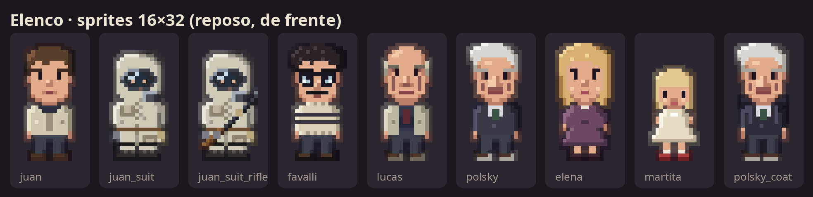
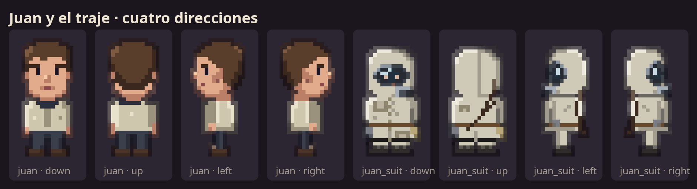

- Hoja: `public/assets/chars2.png` (celdas de 16×32; 8 columnas × 4 direcciones por personaje). Se edita en `art/sprites/` y se arma con `npm run sprites:pack`.
- Personajes: juan, juan_suit, juan_suit_rifle, favalli, lucas, polsky, elena, martita, polsky_coat.
- Rasgos que identifican a cada uno:
  - **Favalli:** anteojos de marco grueso.
  - **Lucas:** pelado y de saco claro.
  - **Polsky:** pelo blanco y traje oscuro.
  - **Elena:** rubia, de vestido violeta.
  - **Martita:** el único toque de rojo vivo en la casa.
  - **El traje:** tela engomada con parches, visera elíptica y filtro hecho con una lata.

**Pendiente**
- [ ] Revisar que todos los adultos tengan la misma altura y proporción en el elenco.
- [ ] Definir si el traje necesita más variantes (por ejemplo, sin capucha). El diseño base del traje ya está en [PI-3](#pi-3--juan-con-traje-unificado-al-retrato).

## Animaciones

GIF con el ritmo real: [Juan](doc/laminas/anim_caminata_juan.gif) · [traje](doc/laminas/anim_caminata_juan_suit.gif) · lámina del traje: [anim_caminata_juan_suit.png](doc/laminas/anim_caminata_juan_suit.png)

- Caminata de 6 cuadros por dirección.
  - Tiempos: 150, 95, 95, 150, 95 y 95 ms. El contacto dura más que los intermedios.
  - Cabeceo: baja, baja y sube de golpe. La cabeza nunca cambia de forma, solo se desplaza.
- Reposo de 2 cuadros.

**Pendiente**
- [ ] Inventario de animaciones que faltan: agarrar o interactuar, ponerse el traje, disparar, morir, sentarse a la mesa, cebar mate.
- [ ] Animaciones de reposo con vida para los personajes sentados en el truco.

## Diálogos y retratos

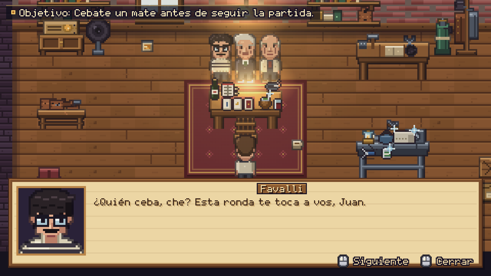
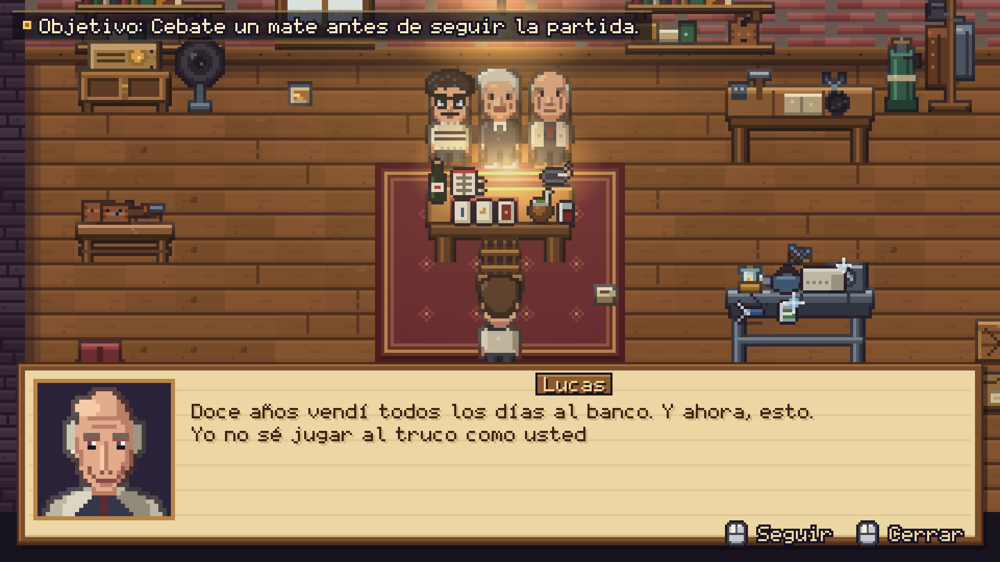

**En el juego hoy** (hasta que entre PI-2): retratos de color aparte, a 64×64 en la caja de diálogo y a 32×32 en el panel.

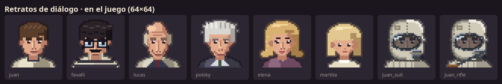
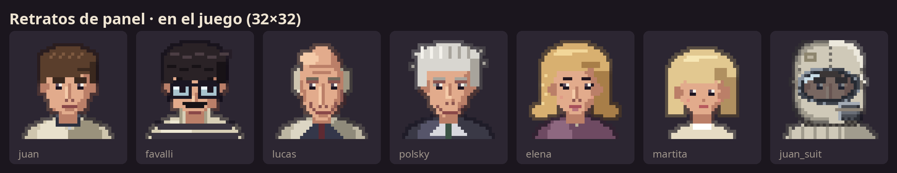

**Decidido el 18/11:** los retratos pasan a ser las cabezas de los sprites, con cabeza y hombros. Juan con traje es la excepción y conserva su retrato. Ver [PI-2](#pi-2--retratos-de-diálogo--cabezas-de-los-sprites).
El duotono (`art/concept/portraits_duo.py`, 17/11) queda descartado para los diálogos.

## Viñetas

Las secuencias de historieta: recuadros sobre papel, cartelas amarillas y globos.

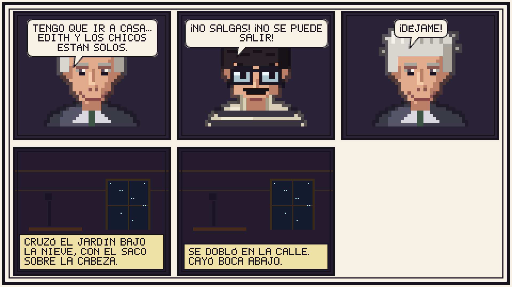
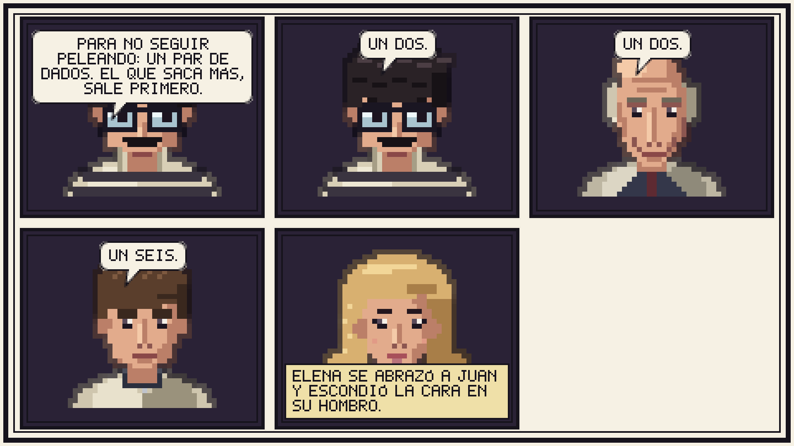

Cartela suelta (intro):

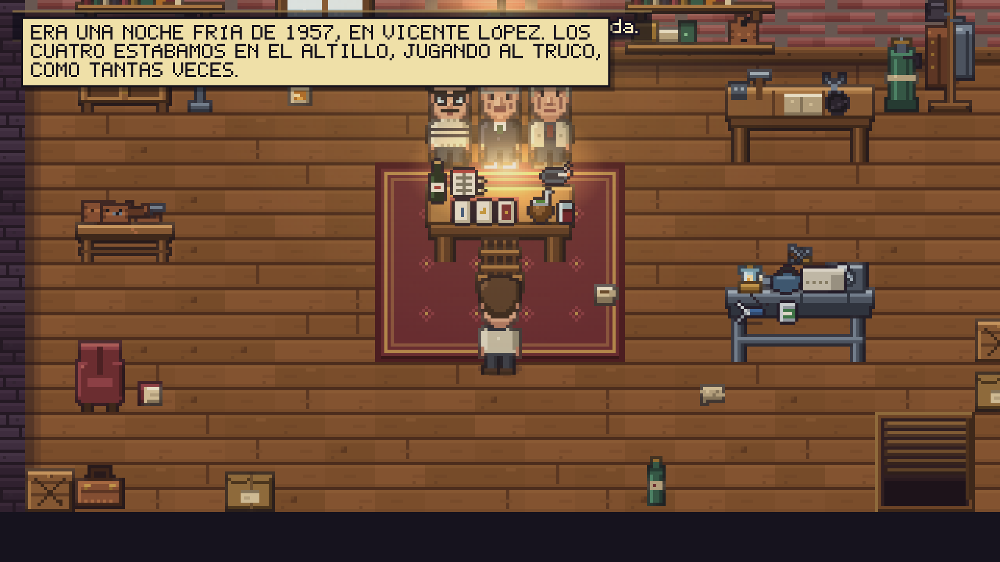

- Hoy los recuadros reutilizan los retratos de color y las vistas de la ventana.
- Colores en `src/comic.js`: tinta `#16131c`, papel `#f6f1e4`, cartela `#efe0a8`, recuadro oscuro `#2a2236`.

**Pendiente**
- [ ] **Decidir:** cuando entre PI-2, ¿las viñetas también usan las cabezas de los sprites, o siguen con los retratos de color? Hoy usan los de color.
- [ ] Los recuadros que muestran solo la ventana o el negro de "la lámpara se apagó" se ven vacíos. Hacen falta ilustraciones propias: la lámpara, el jardín nevado, Polsky caído.
- [ ] Las grillas quedan con huecos (recuadros vacíos al final de la página). Hay que revisar la composición de cada página.

## Escenarios y construcción

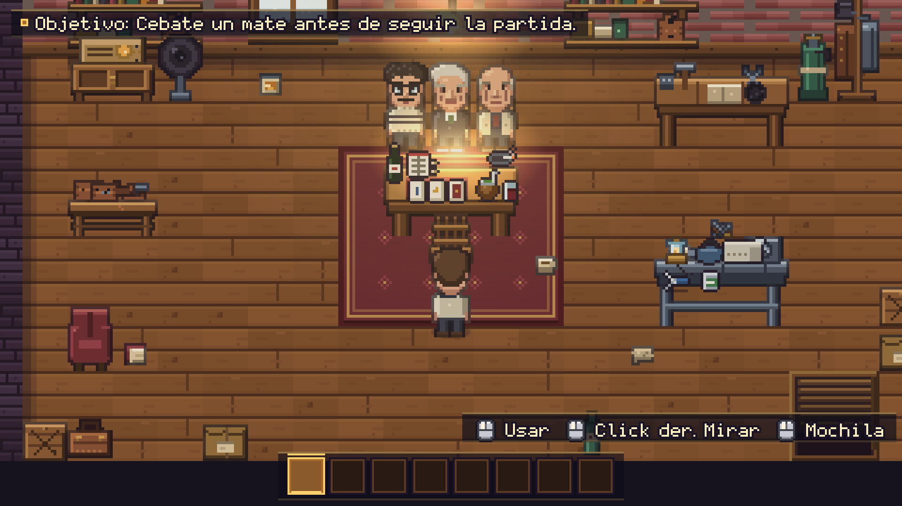

Piezas:

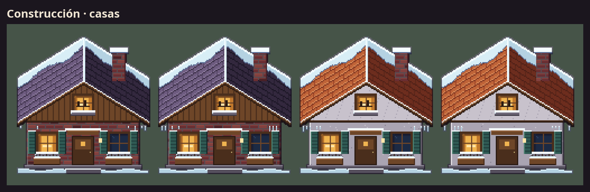
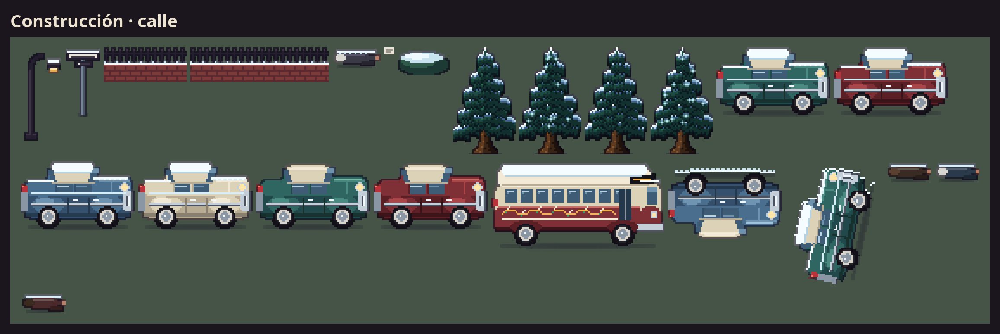

- El mundo se ve con un zoom de alrededor de 1,5× sobre la vista, siempre pixel-perfect (`src/viewport.js`).
- Las paredes interiores se ven de frente, como en Stardew, para que cada ambiente se entienda.

**Pendiente**
- [x] Planta baja completa: diseñada en [PI-6](#pi-6--planta-baja-completa).
- [ ] Calle: sumar fondo poblado (segunda fila de techos, tanques de agua, cables).

## Objetos

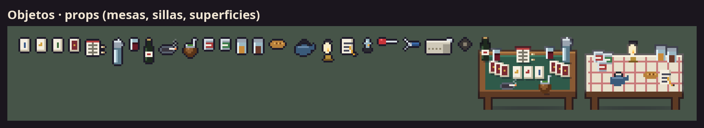

- Las mesas tienen la tapa lisa y contorno, así se leen bien con el zoom.
- Los objetos chicos de las superficies son los que se pueden agarrar.

**Pendiente**
- [ ] Revisar que los objetos con los que se puede interactuar se distingan de los decorativos.

## HUD

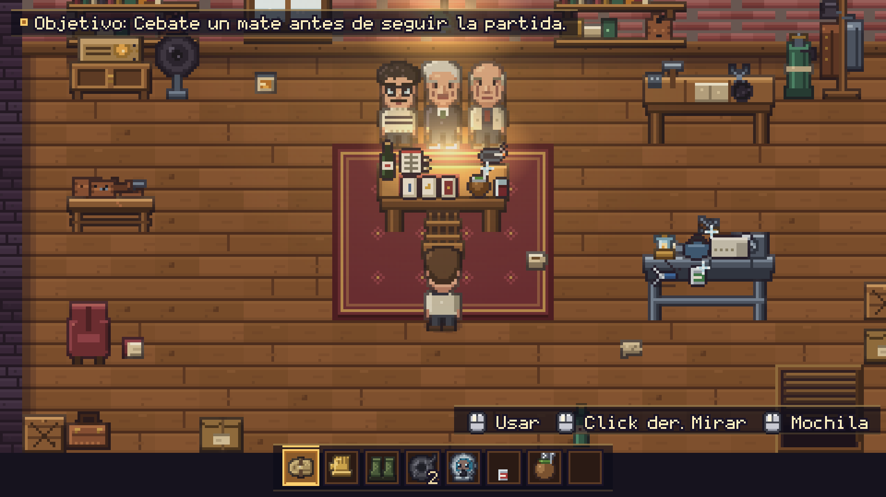
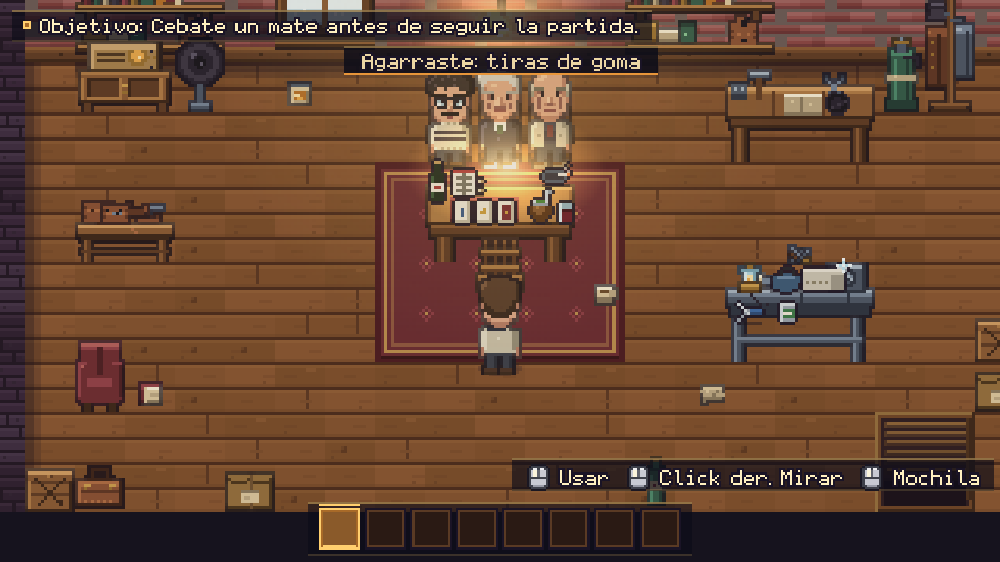

Arriba a la izquierda va el objetivo. Abajo van la barra de acciones (Usar / Click der. Mirar / Mochila) y la barra de 8 casilleros. Los avisos cortos aparecen arriba, al centro.

**Pendiente**
- [x] Glifo de click derecho y lugar del aviso: diseñado en [PI-5](#pi-5--hud-glifo-de-click-derecho-y-lugar-del-aviso).

## Inventario, fabricar y cofres

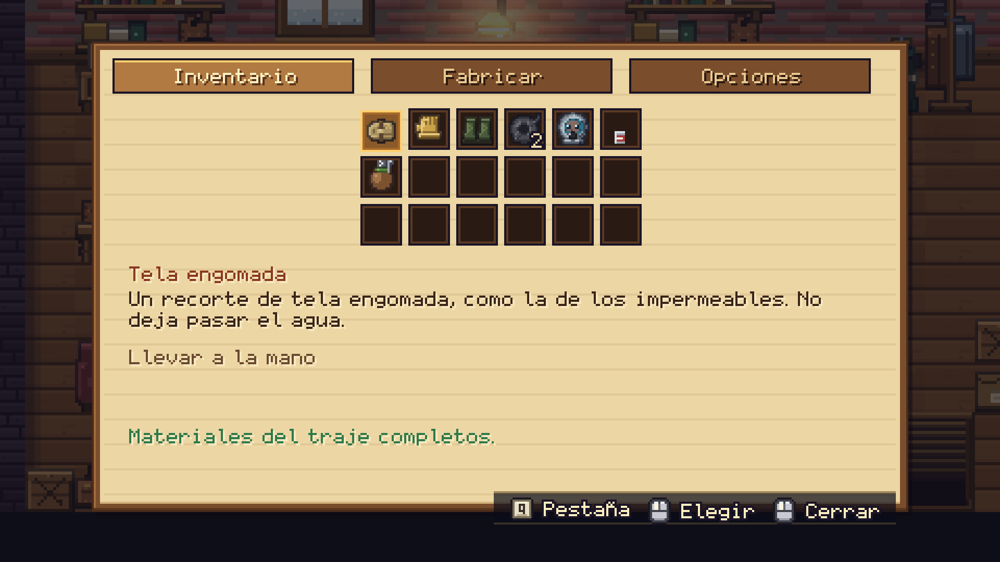

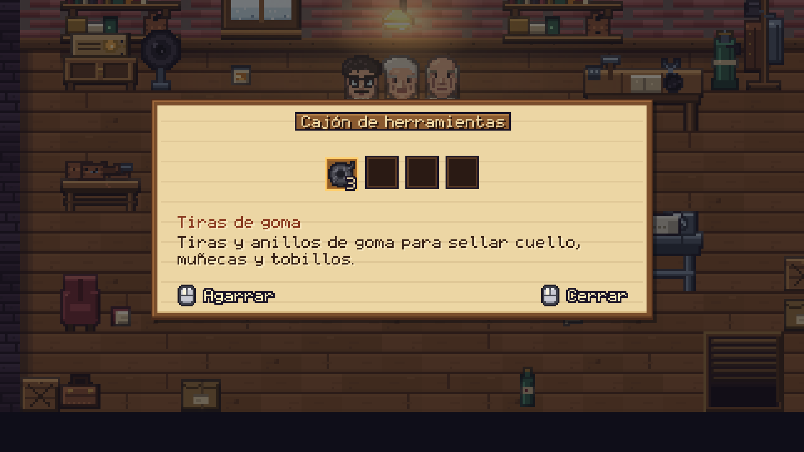

Ítems:

- Es un panel de papel con pestañas (Inventario, Fabricar, Opciones), con la descripción del ítem abajo.

## Menús y pantallas

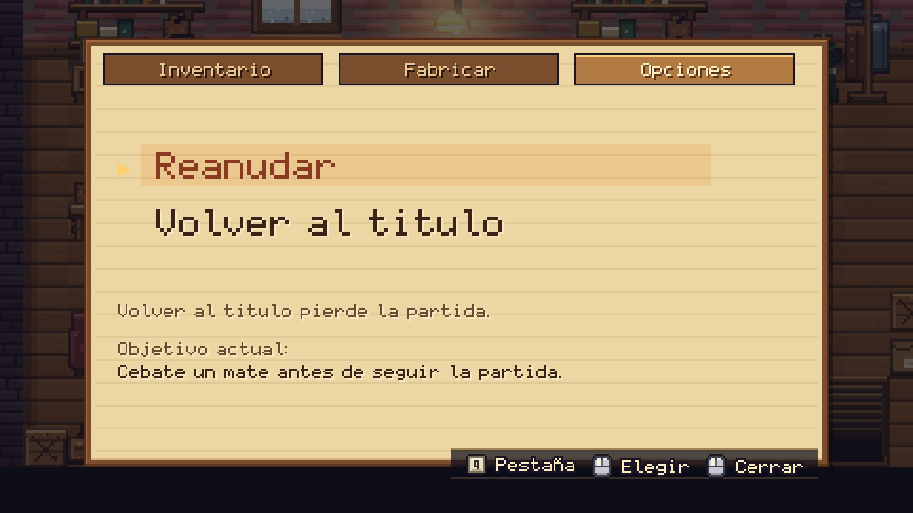
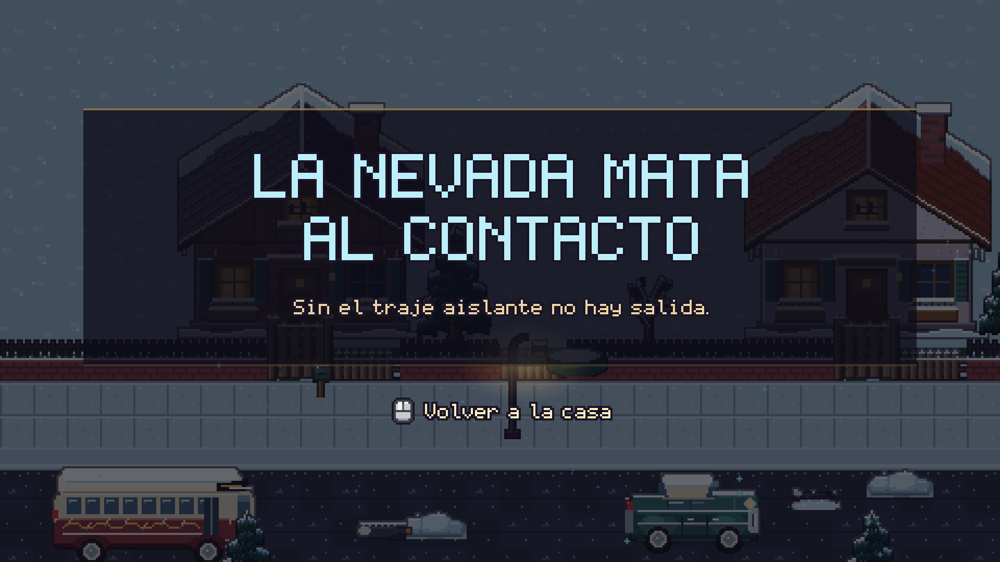

Piezas:

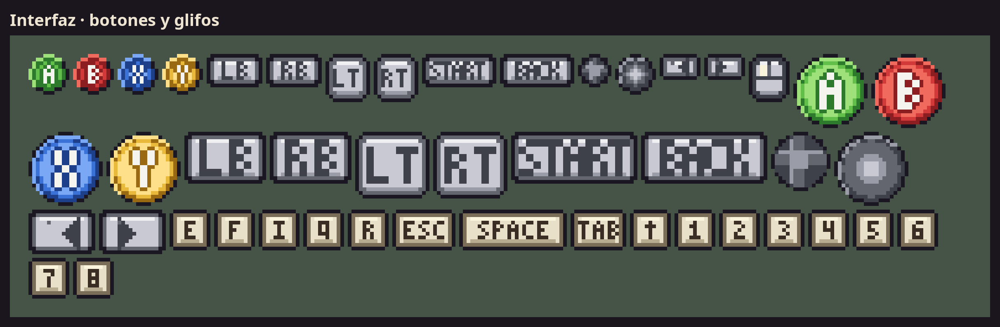

**Pendiente**
- [ ] Capturar Controles y Créditos. El script todavía no logra navegar el menú del título.
- [x] El cartel de madera del título se queda (18/11). El título nuevo está en [PI-8](#pi-8--menú-inicial-logo-eternauta).

## Cursor

- Es el guante blanco del pack descargado (`art/cursores/src_pointer.png`), pasado a la paleta beige.
- Es un cursor de hardware (CSS): no tiene demora detrás del mouse.
- **Click:** la mano entera se hunde 1 px en diagonal y se oscurece un tono. Queda hundida mientras el botón está apretado, con un mínimo de 120 ms.
- **Lejos:** la misma mano en gris.
- Fuente: `art/sprites/cursor/`.

**Pendiente**
- [ ] Averiguar el autor del pack del guante y ponerlo en Créditos.
- [ ] Hover: hoy no cambia nada al pasar por encima de algo clickeable.
- [ ] La versión gris (lejos) existe, pero ninguna escena la activa.

## Enemigos y minijuego

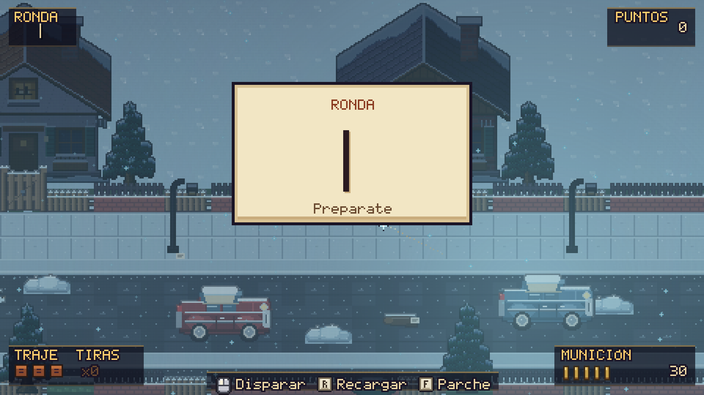

Diseño completo en `Eternauta-enemigos.pdf` (cascarudos y la Mano):

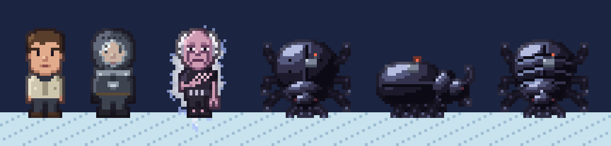

**Pendiente**
- [ ] La Mano (enemigo): está diseñada, pero no está en el juego.

En el combate no se ve el guante del cursor, solo la mira: ver [PI-4](#pi-4--en-el-combate-no-hay-guante-solo-la-mira).

## Efectos e iluminación

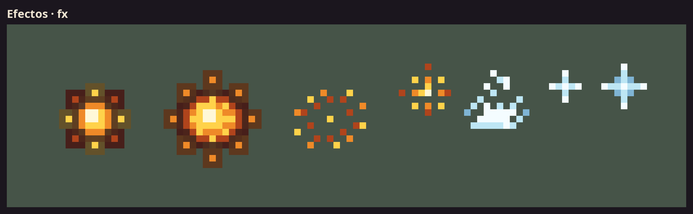
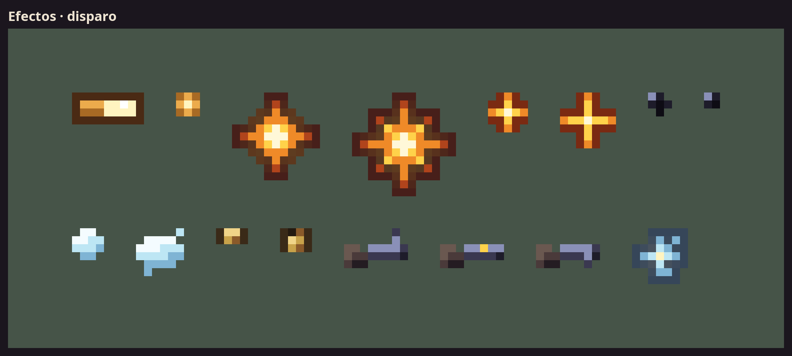

### Luz del apagón

Hoy en el juego (velo azul plano, el sistema viejo de `src/lighting.js`):

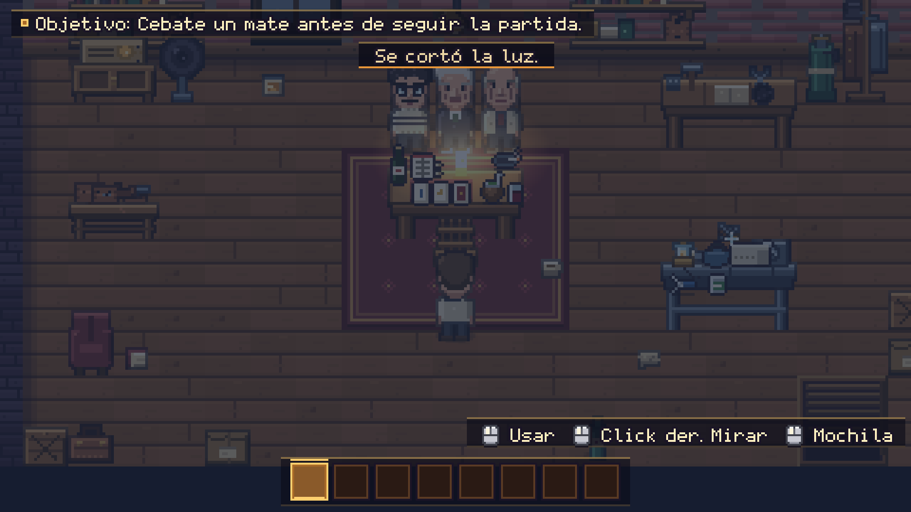

**El rediseño está cerrado y espera al worker:** ver [PI-1](#pi-1--luz-del-apagón). Incluye las reglas, las decisiones y los concepts del altillo con el pucho, la planta baja, la calle y la lamparita apagada.

---

## Tablero de pendientes

Diseño que **falta hacer**, en el orden sugerido. Lo que ya está diseñado y aprobado pasa a [Por implementar](#por-implementar). Cada ítem se tacha acá y en la sección de su área.

| # | Área | Tarea | Estado |
|---|---|---|---|
| 1 | Viñetas | Ilustrar los recuadros vacíos y decidir si pasan a las cabezas de los sprites | abierto |
| 2 | Animaciones | Inventario y prioridades de las animaciones que faltan | abierto |
| 3 | Enemigos | Sumar la Mano al juego | abierto |
| 4 | Cursor | Crédito del pack, hover y versión de lejos | abierto |
| 5 | Menús | Capturar Controles y Créditos (el título nuevo está en PI-8) | abierto |
